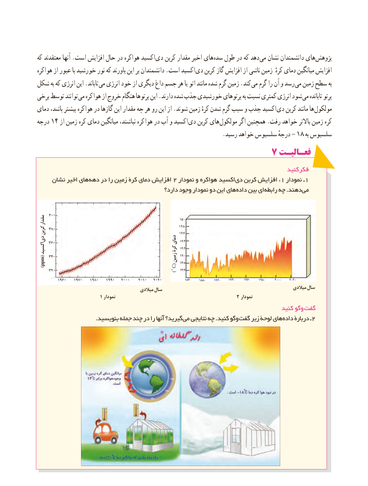

# PDF page 63

که معتقدند آنها .است افزایش حال در هواکره اکسید دی کربن مقدار اخیر های سده طول در که دهد می نشان دانشمندان های پژوهش
هواکره از عبور با خورشید نور که باورند این بر دانشمندان .است اکسید دی کربن گاز افزایش از ناشی زمین کرهٴ  دمای میانگین افزایش
شکل به که انرژی این .تاباند می انرژی خود از دیگری داغ جسم هر یا اتو مانند شده گرم زمین .کند می گرم را آن و رسد می زمین سطح به
برخی توسط توانند می کره هوا از خروج هنگام پرتوها این .دارند شده جذب خورشیدی پرتوهای به نسبت کمتری انرژی شود می تابانده پرتو
دمای باشد، بیشتر هواکره در گازها این مقدار چه هر رو این از .شوند زمین کرهٔ شدن گرم سبب و جذب اکسید دی کربن مانند ها مولکول
درجه 14 از زمین کره دمای میانگین نباشند، کره هوا در آب و اکسید دی کربن های مولکول اگر همچنین .رفت خواهد باالتر زمین کره
     .-رسید خواهد سلسیوس درجهٔ  18 به سلسیوس
                                          7 فعـالیـت
                                                                                     کنید فکر
    نشان اخیر های دهه در را زمین کرۀ دمای افزایش 2 نمودار و کره هوا اکسید دی کربن افزایش ،1 نمودار ـ 1
                                               دارد؟ وجود نمودار دو این های داده بین ای رابطه چه .دهند می

مقدار                                                                                            15/0
                                                                                                   14/8
کربن                                                                                            14/6
دی                                                  دمای 14/4
                                        کرۀ 14/2اکسید
                                                     زمین 14/0                                                                                                    13/8)ppm(
                                                         )0 C( 13/6

                                                                                         1860     1880     1920     1940     1960     1980      2000     2020
                                                                                                                 میالدی سال                                              میالدی سال
                                1 نمودار                                            2 نمودار
                                                                                   کنید وگو گفت
 . بنویسید جمله چند در را آنها گیرید؟می نتایجی چه .کنید وگو گفت زیر لوحۀ های داده دربارۀ ـ 2
                                      * *

                                   5555

