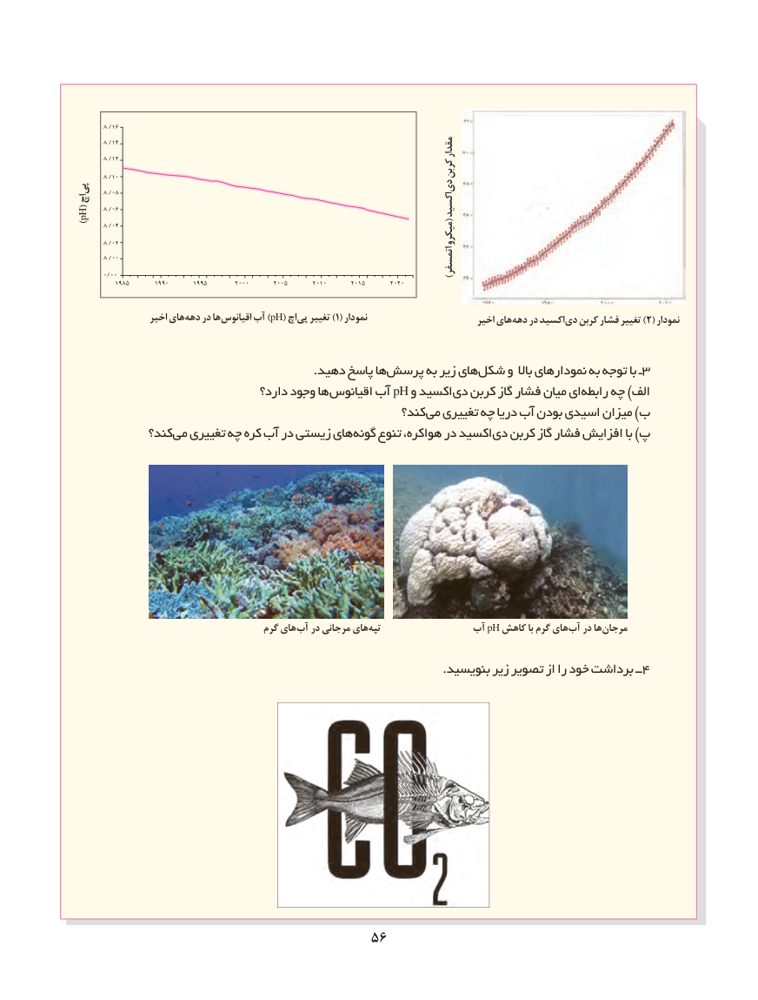

# PDF page 64

8 /16
         8 /14                                                                              مقدار
         8 /12
         8 /10                                                               کربن
پی    8 /08                               دی
اچ
         8 /06                                                                                          اکسید)pH(                 (
         8           /04

         8           /02                                                                              میکرو

         8 /00         0/00                                                                                              اتمسفر)
            1985       1990       1995        2000       2005       2010       2015       2020

                 اخیر های دهه در ها )اقیانوس آب pH( اچ )پی تغییر  1( نمودار                         اخیر های دهه در اکسید )دی کربن فشار تغییر 2( نمودار

                                                             .دهید پاسخ ها پرسش به زیر های شکل و باال نمودارهای به توجه با ـ 3
                                 دارد؟ وجود ها اقیانوس آب pH و اکسید دی کربن گاز فشار میان ای رابطه چه )الف
                                                      کند؟ می تغییری چه دریا آب بودن اسیدی میزان )ب
             کند؟ می تغییری چه کره آب در زیستی های گونه تنوع هواکره، در اکسید دی کربن گاز فشار افزایش با )پ

                                      گرم های آب در مرجانی های تپه               آب pH کاهش با گرم های آب در ها مرجان

    .4بنویسید زیر تصویر از را خود برداشت ــ

                                     5656

