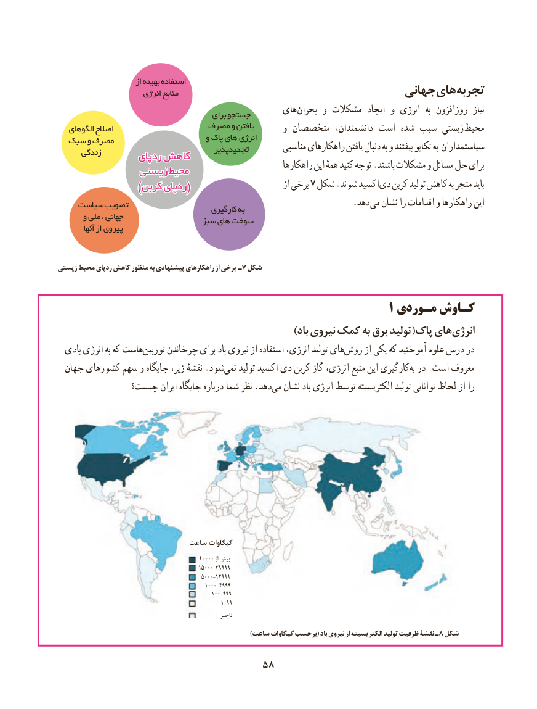

# PDF page 66

از بهینه استفاده
                        انرژی منابع                                    جهانیهای تجربه
                                           برای جستجو       های بحران و مشکالت  ایجاد و انرژی  به روزافزون  نیاز
                            مصرف و یافتن   الگوهای اصالح                                       و متخصصان دانشمندان، است شده سبب زیستی محیط                                     و پاک های انرژی  سبک و مصرف                                         تجدیدپذیر         مناسبی راهکارهای یافتن دنبال به و بیفتند تکاپو به سیاستمداران      زندگی        ردپایردپای کاهشکاهش                                                            راهکارها این همهٔ کنید توجه .باشند مشکالت و مسائل حل برای              زیستیزیستی محیطمحیط
   )()(کربنکربن ردپایردپای                            از برخی 7 شکل .شوند اکسید دی کربن تولید کاهش به منجر باید
    سیاست تصویب                       . دهد می نشان را اقدامات و راهکارها این                                          کارگیری به
      و ملی ، جهانی                                سبز های سوخت
          آنها از پیروی

زیستی محیط ردپای کاهش منظور به پیشنهادی راهکارهای از برخی ـ 7 شکل

                                                             1 مـوردی کـاوش
                                                        ))بادباد نیروینیروی کمککمک بهبه برقبرق تولیدتولید((پاکپاک هایهایانرژیانرژی‌‌
  بادی انرژی به که هاستتوربین‌     چرخاندن برای باد نیروی از استفاده انرژی، تولید های‌روش از یکی که آموختید علوم درس در
  جهان کشورهای سهم و جایگاه زیر، نقشۀ .شود‌نمی تولید اکسید دی کربن گاز انرژی، منبع این کارگیریبه‌ در .است معروف
              چیست؟ ایران جایگاه درباره شما نظر .دهدمی‌  نشان باد انرژی توسط الکتریسیته تولید توانایی لحاظ از را

                             ساعت گیگاوات
                                                ۴۰۰۰۰ از بیش
                                                ۱۵۰۰۰-۳۹۹۹۹
                                                ۵۰۰۰-۱۴۹۹۹
                                                  ۱۰۰۰-۴۹۹۹
                                                    ۱۰۰-۹۹۹
                                               ۱-۹۹
                                                                     ناچیز
                                                                       )ساعت گیگاوات برحسب( باد نیروی از الکتریسیته تولید ظرفیت نقشۀ ـ8 شکل

                                 5858

