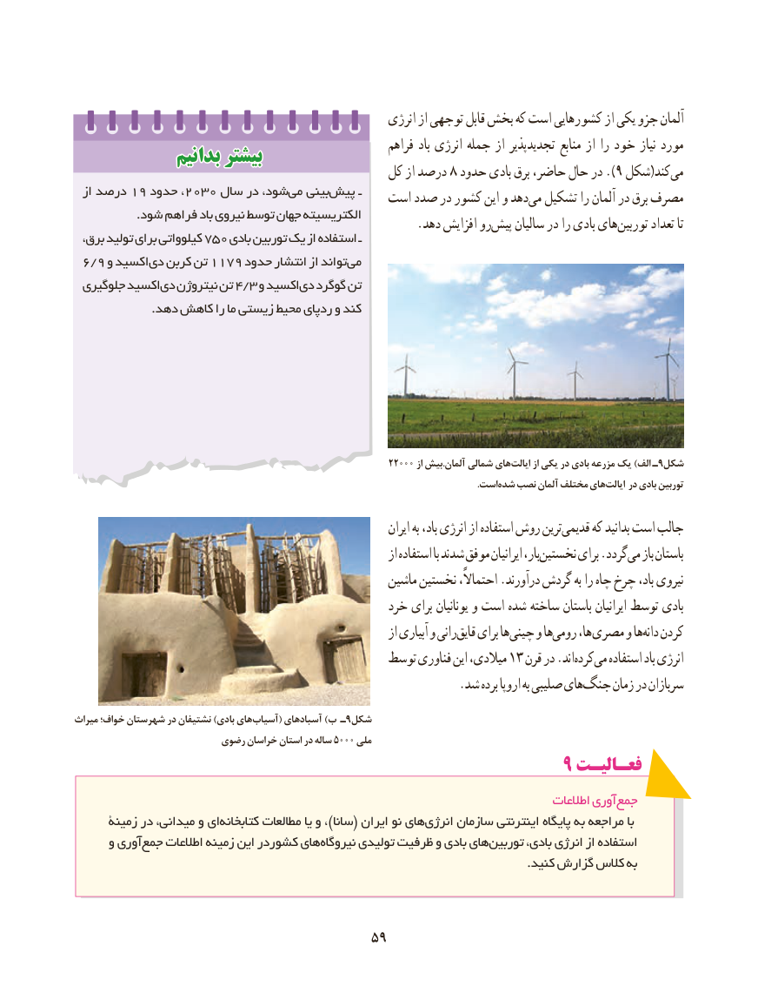

# PDF page 67

انرژی از توجهی قابل بخش که است کشورهایی از یکی جزو آلمان
                                                             فراهم باد انرژی جمله از تجدیدپذیر منابع از را خود نیاز مورد              بدانیمبدانیم بیشتربیشتر                                           کل از درصد ۸ حدود بادی برق حاضر، حال در ).9 شکل(کندمی‌
 از۱۹درصد   حدود۲۰۳۰،     سال در شود،می‌   بینیپیش‌        ـ   است صدد در کشور این و دهدمی‌  تشکیل را آلمان در برق مصرف
                .شود فراهم باد نیروی توسط جهان الکتریسیته .‌دهد افزایش روپیش سالیان در را بادی هایتوربین‌      تعداد تا
  برق، تولید برای کیلوواتی 750 بادی توربین یک از استفاده ـ
 6/9 و اکسیددی‌  کربن تن 1179 حدود انتشار از تواندمی‌
 جلوگیری اکسیددی‌  نیتروژن تن 4/3 و اکسیددی‌  گوگرد تن
                    .دهد کاهش را ما زیستی محیط ردپای و کند

                                                            ۲۲۰۰۰ از بیش‌.آلمان شمالی هایایالت‌      از یکی در بادی مزرعه یک )الف ـ 9شکل
                                   .‌استشده نصب آلمان مختلف هایایالت‌    در بادی توربین

                                                                        ایران به باد، انرژی از استفاده روش ترینقدیمی‌     که بدانید است جالب
                                                                   از استفاده با شدند موفق ایرانیان بار،نخستین‌       برای .گرددمی‌   باز باستان
                                                      ماشین نخستین احتماالً، .درآورند گردش به را چاه چرخ باد، نیروی
                                                خرد برای یونانیان و است شده ساخته باستان ایرانیان توسط بادی
                                                                   از آبیاری و رانیقایق‌   برای هاچینی‌    و هارومی‌     ها، مصری‌     و هادانه‌  کردن
                                            توسط فناوری این میالدی، ۱۳ قرن در .اندکرده‌  می‌  استفاده باد انرژی
      .‌شد برده اروپا به صلیبی هایجنگ زمان در سربازان
میراث خواف؛ شهرستان در نشتیفان )بادی هایآسیاب‌       ( آسبادهای )ب ـ9شکل
         رضوی۵۰۰۰خراسان استان در ساله     ملی
                                                       9 فعـالیـت
                                                                                        اطالعات آوریجمع‌
      زمینۀ در میدانی، و ایکتابخانه‌       مطالعات یا و ، )سانا( ایران نو هایانرژی‌     سازمان اینترنتی پایگاه به مراجعه با
      و آوریجمع‌    اطالعات زمینه این کشوردر هاینیروگاه‌      تولیدی ظرفیت و بادی هایتوربین‌       بادی، انرژی از استفاده
                                                                                                                   .کنید گزارش کالس به

                                     5959

