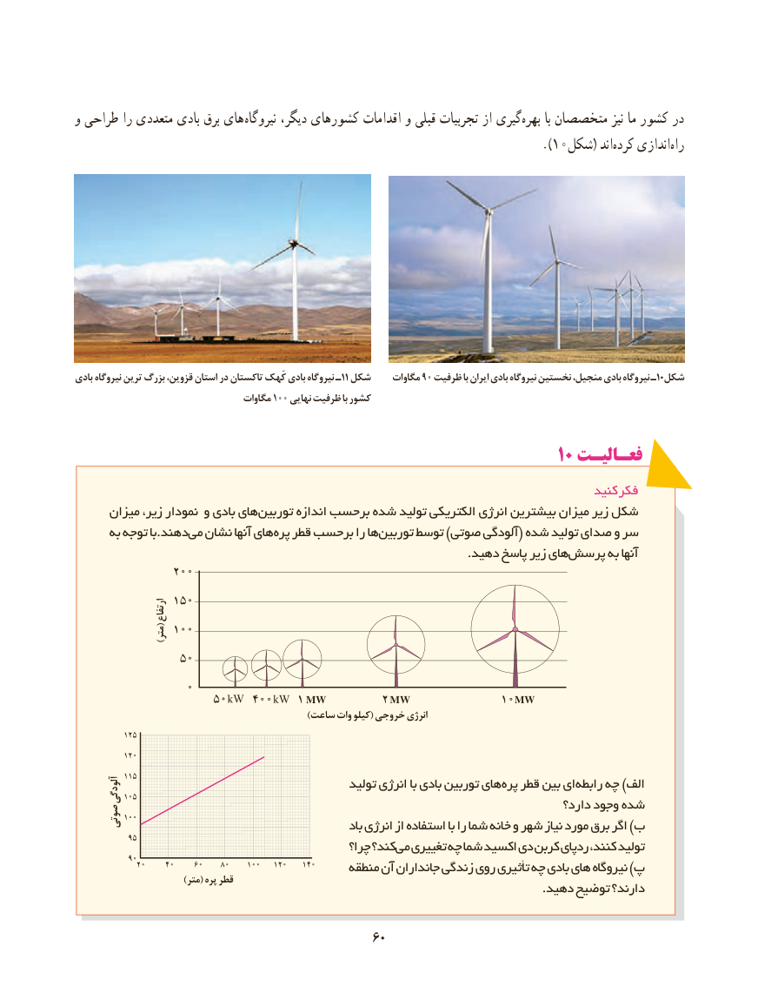

# PDF page 68

و طراحی را متعددی بادی برق های نیروگاه دیگر، کشورهای اقدامات و قبلی تجربیات از گیریبهره‌      با متخصصان نیز ما کشور در
                                                                                           ).۱0شکل( اندکرده‌    اندازی‌راه

بادی نیروگاه ترین بزرگ قزوین، استان در تاکستان کَهک بادی نیروگاه ـ11 شکل    مگاوات۹۰ ظرفیت با ایران بادی نیروگاه نخستین منجیل، بادی نیروگاه ـ10شکل
                                 مگاوات۱۰۰ نهایی ظرفیت با کشور

                                                             10 فعـالیـت
                                                                                      کنید فکر
      میزان زیر، نمودار و بادی هایتوربین‌       اندازه برحسب شده تولید الکتریکی انرژی بیشترین میزان زیر شکل
      به توجه با.دهندمی‌  نشان آنها هایپره‌  قطر برحسب را هاتوربین‌     توسط )صوتی آلودگی( شده تولید صدای و سر
                                                                                                    .دهید پاسخ زیر هایپرسش‌      به آنها

                      ارتفاع
    (متر)

                       MW      MW          MW
                                                            )ساعت وات کیلو( خروجی انرژی

        آلودگی                                         تولید انرژی با بادی توربین های پره قطر بین ای رابطه چه )الف
                                                                                       دارد؟ وجود شده
      صوتی                                                           باد انرژی از استفاده با را شما خانه و شهر نیاز مورد برق اگر )ب
                                                  چرا؟ کند؟می‌  تغییری چه شما اکسید دی کربن ردپای کنند، تولید
                                             منطقه آن جانداران زندگی روی تأثیری چه بادی های نیروگاه )پ                            )متر( پره قطر                                                                                                                       .دهید توضیح دارند؟

                                             6060

