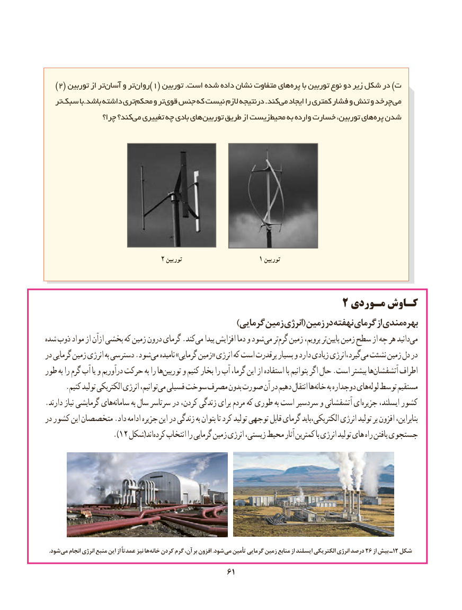

# PDF page 69

)2( توربین از تر آسان و تر روان)١( توربین .است شده داده نشان متفاوت های پره با توربین نوع دو زیر شکل در )ت
   تر سبک با.باشد داشته تری محکم و تر قوی جنس که نیست الزم درنتیجه .کند می ایجاد را کمتری فشار و تنش و چرخد می
                 چرا؟ کند؟ می تغییری چه بادی های توربین طریق از زیست محیط به وارده خسارت توربین، های پره شدن

                               ٢ توربین                     ١ توربین

                                                  2 مـوردی کـاوش
                                                    ))گرماییگرمایی زمینزمین انرژیانرژی(( زمینزمین دردر نهفتهنهفته گرمایگرمای ازاز مندیمندیبهرهبهره‌‌
شده ذوب مواد از ازآن بخشی که زمین درون گرمای .کندمی‌   پیدا افزایش دما و شود می ترگرم‌  زمین برویم، ترپایین‌   زمین سطح از چه هر دانیدمی‌
در گرمایی زمین انرژی به دسترسی .شودمی‌   نامیده »گرمایی زمین« انرژی که است پرقدرت بسیار و دارد زیادی انرژی،گیرد‌   می‌  نشئت زمین دل در
طور به را گرم آب یا و درآوریم حرکت به را هاتوربین‌     و کنیم بخار را آب گرما، این از استفاده با بتوانیم اگر حال .است بیشتر هاآتشفشان‌       اطراف
      .کنیم تولید الکتریکی انرژی توانیم،می‌  فسیلی سوخت مصرف بدون صورت آن در دهیم انتقال هاخانه‌     به دوجداره هایلوله‌  توسط مستقیم
.دارند نیاز گرمایشی هایسامانه‌       به سال سرتاسر در کردن، زندگی برای مردم که طوری به است سردسیر و آتشفشانی ایجزیره‌     ایسلند، کشور
در کشور این متخصصان .داد ادامه جزیره این در زندگی به بتوان تا کرد تولید توجهی قابل گرمای باید،بنابراین،‌ الکتریکی انرژی تولید بر افزون
                  ).12 شکل(اندکرده‌   انتخاب را گرمایی زمین انرژی زیستی، محیط آثار کمترین با انرژی تولید های راه یافتن جستجوی

  .شود می انجام انرژی منبع این از عمدتاً نیز ها خانه کردن گرم آن، بر افزون .شود می تأمین گرمایی زمین منابع از ایسلند الکتریکی انرژی درصد 26 از بیش ـ12 شکل
                                              6161

