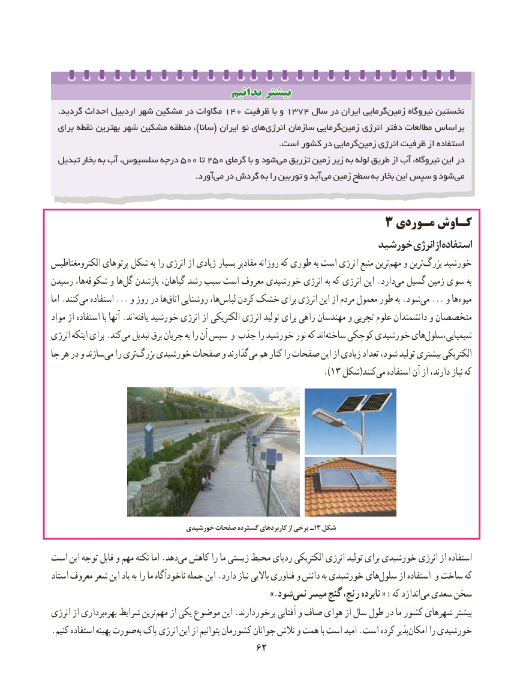

# PDF page 70

بدانیمبدانیم بیشتربیشتر
  .گردید احداث اردبیل شهر مشکین۱۴۰‌      در مگاوات   ظرفیت۱۳۷۴با و     سال در ایران گرماییزمین‌     نیروگاه نخستین
  برای نقطه بهترین شهر مشکین‌      منطقه ،)سانا( ایران نو هایانرژی‌     سازمان گرماییزمین‌     انرژی دفتر مطالعات براساس
      .‌است کشور در گرماییزمین انرژی ظرفیت از استفاده
  تبدیل بخار به آب سلسیوس، درجه ۵۰۰ تا۲۵۰ گرمای با و شودمی‌  تزریق زمین زیر به لوله طریق از آب نیروگاه، این در
              .‌آوردمی در گردش به را توربین و آید می زمین سطح به بخار این سپس و شود می

                                         3 مـوردی کـاوش
                                                        خورشیدخورشیدانرژیانرژیازازاستفادهاستفاده
الکترومغناطیس پرتوهای شکل به را انرژی از زیادی بسیار مقادیر روزانه که طوری به است انرژی منبع ترینمهم‌   و ترینبزرگ‌    خورشید
رسیدن ها،شکوفه‌     و هاگل‌   بازشدن گیاهان، رشد سبب است معروف خورشیدی انرژی به که انرژی این .داردمی‌  گسیل زمین سوی به
اما .کنندمی‌   استفاده ... و روز در هااتاق‌   روشنایی ها،لباس‌    کردن خشک برای انرژی این از مردم معمول طور به .شودمی‌  ... و هامیوه‌
مواد از استفاده با آنها .اندیافته‌   خورشید انرژی از الکتریکی انرژی تولید برای راهی مهندسان و تجربی علوم دانشمندان و متخصصان
انرژی اینکه برای .کندمی‌  تبدیل برق جریان به را آن سپس و جذب را خورشید نور که اندساخته‌    کوچکی خورشیدی هایشیمیایی،سلول‌
جا هر در و سازندمی‌   را تریبزرگ‌    خورشیدی صفحات و گذارندمی‌  هم کنار را صفحات این از زیادی تعداد شود، تولید بیشتری الکتریکی
                                                                               ). 13 شکل(کنندمی‌   استفاده آن از دارند، نیاز که

                                  خورشیدی صفحات گسترده کاربردهای از برخی ـ 13 شکل

است این توجه قابل و مهم نکته اما .دهدمی‌  کاهش را ما زیستی محیط ردپای الکتریکی انرژی تولید برای خورشیدی انرژی از استفاده
استاد معروف شعر این یاد به را ما ناخودآگاه جمله این .دارد نیاز باالیی فناوری و دانش به خورشیدی هایسلول‌     از استفاده و ساخت که
                          .»‌شودنمی میسر گنج رنج، نابرده « :که اندازدمی‌  سعدی سخن
انرژی از برداریبهره‌   شرایط ترینمهم‌    از یکی موضوع این .برخوردارند آفتابی و صاف هوای از سال طول در ما کشور شهرهای بیشتر
. کنیم استفاده بهینه صورت به پاک انرژی این از بتوانیم کشورمان جوانان تالش و همت با است امید .است کرده پذیرامکان‌     را خورشیدی
                                       6262

