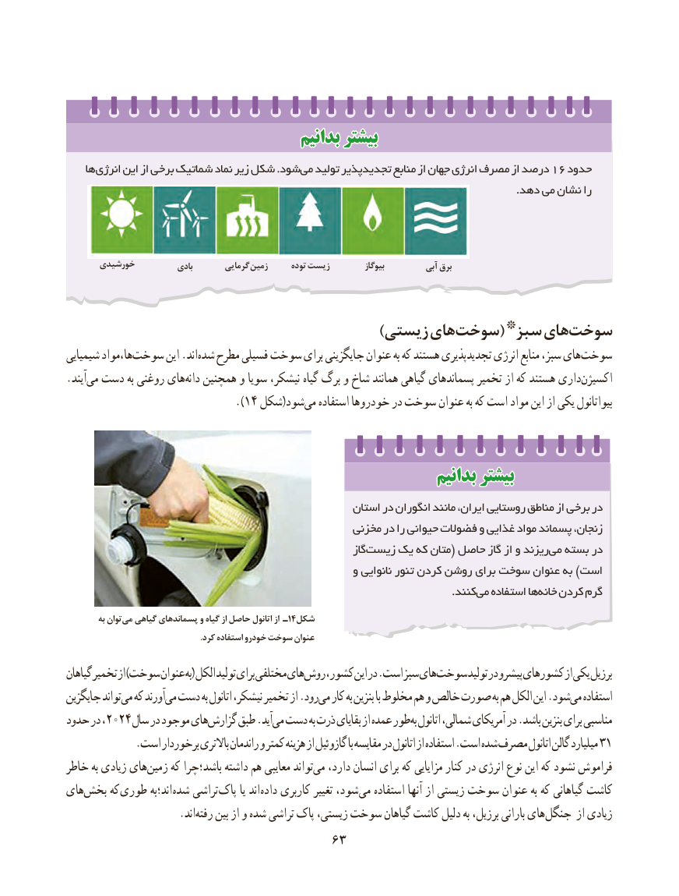

# PDF page 71

بدانیمبدانیم بیشتربیشتر
    ها انرژی این از برخی شماتیک نماد زیر شکل .شودمی۱۶‌  تولید تجدیدپذیر منابع از جهان انرژی مصرف از درصد   حدود
                                                                                                                               .دهد می نشان را

      خورشیدی           بادی        گرمایی زمین      توده زیست          گازبیو             آبی برق

                                            *                                                   )زیستی هایسوخت‌( سبز هایسوخت‌
شیمیایی مواد،ها‌ سوخت‌       این .اندشده‌   مطرح فسیلی سوخت برای جایگزینی عنوان به که هستند تجدیدپذیری انرژی منابع سبز، هایسوخت‌
.‌آیندمی دست به روغنی هایدانه‌   همچنین و سویا نیشکر، گیاه برگ و شاخ همانند گیاهی پسماندهای تخمیر از که هستند داریاکسیژن‌
                              ).14 شکل(شودمی‌   استفاده خودروها در سوخت عنوان به که است مواد این از یکی بیواتانول

                                                         بدانیمبدانیم بیشتربیشتر
                                                   استان در انگوران مانند ایران، روستایی مناطق از برخی در
                                                 مخزنی در را حیوانی فضوالت و غذایی مواد پسماند زنجان،
                                                                گاززیست‌    یک که متان( حاصل گاز از و ریزندمی‌  بسته در
                                                   و نانوایی تنور کردن روشن برای سوخت عنوان به )است
                            .‌کنندمی استفاده هاخانه‌   کردن گرم
         به توانمی‌  گیاهی پسماندهای و گیاه از حاصل اتانول از ـ14شکل
                                                               .کرد استفاده خودرو سوخت عنوان
گیاهان تخمیر از )سوخت عنوان به( الکل تولید برای مختلفی هایروش‌   کشور، این در .است سبز هایسوخت‌       تولید در پیشرو کشورهای از یکی برزیل
جایگزین تواندمی‌  که آورندمی‌ دست به اتانول نیشکر، تخمیر از .رودمی‌  کار به بنزین با مخلوط هم و خالص صورت به هم الکل این .شودمی‌  استفاده
حدود در ،2024 سال در موجود های گزارش طبق .آیدمی‌ دست به ذرت بقایای از عمده طور به اتانول ،مناسبی‌ شمالی آمریکای در .باشد بنزین برای
             .است برخوردار باالتری راندمان و کمتر هزینه از گازوئیل با مقایسه در اتانول از استفاده .است شده مصرف اتانول گالن میلیارد 31
خاطر به زیادی هایزمین‌    که باشد؛چرا داشته هم معایبی تواندمی‌   دارد، انسان برای که مزایایی کنار در انرژی نوع این که نشود فراموش
هایبخش‌     که طوری اند؛به شده تراشی پاک یا اند داده کاربری تغییر شود، می استفاده آنها از زیستی سوخت عنوان به که گیاهانی کاشت
            .‌اندرفته بین از و شده تراشی پاک زیستی، سوخت گیاهان کاشت دلیل به برزیل، بارانی هایجنگل‌       از زیادی
                                    6363

