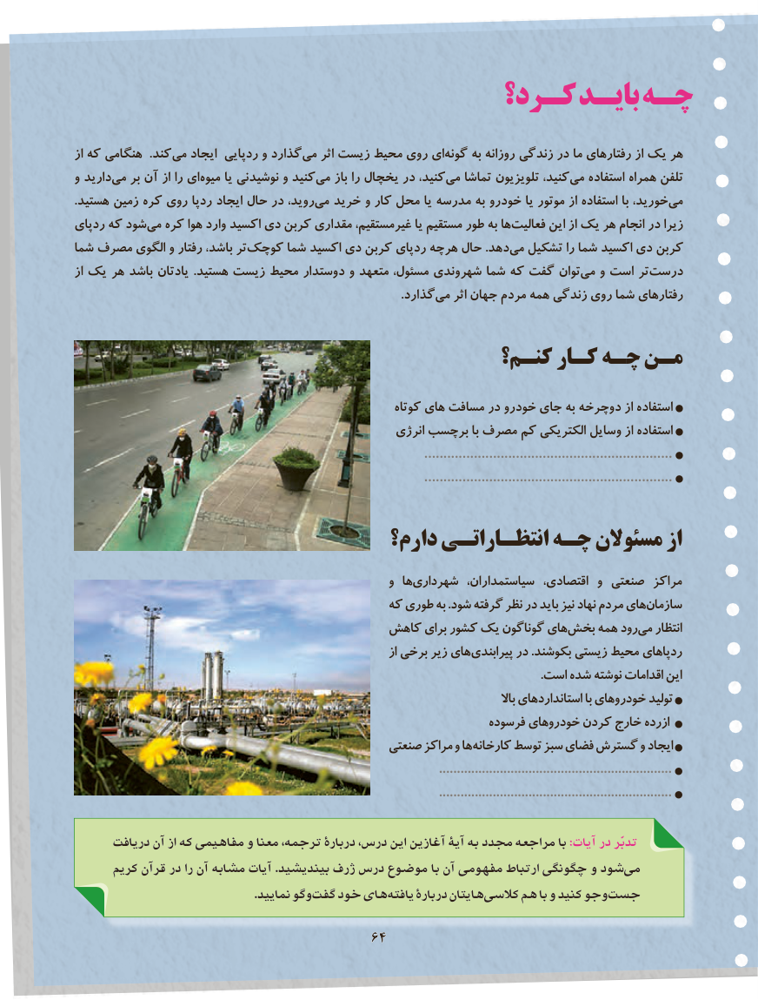

# PDF page 72

كـرد؟ بایـد چـه

از که هنگامی  .کندمی‌   ایجاد ردپایی و گذاردمی‌   اثر زیست محیط روی ایگونه‌     به روزانه زندگی در ما رفتارهای از یک هر
و داریدمی‌   بر آن از را ایمیوه‌     یا نوشیدنی و کنیدمی‌   باز را یخچال در کنید،می‌   تماشا تلویزیون کنید،می‌   استفاده همراه تلفن
.هستید زمین کره روی ردپا ایجاد حال در روید،می‌  خرید و کار محل یا مدرسه به خودرو یا موتور از استفاده با خورید،می‌
ردپای که شودمی‌  کره هوا وارد اکسید دی کربن مقداری غیرمستقیم، یا مستقیم طور به هافعالیت‌      این از یک هر انجام در زیرا
شما مصرف الگوی و رفتار باشد، ترکوچک‌      شما اکسید دی کربن ردپای هرچه حال .دهدمی‌  تشکیل را شما اکسید دی کربن
از یک هر باشد یادتان .هستید زیست محیط دوستدار و متعهد مسئول، شهروندی شما که گفت توانمی‌   و است تردرست‌
                 .‌گذاردمی اثر جهان مردم همه زندگی روی شما رفتارهای

                                         کنـم؟ کـار چـه مـن

                                                            کوتاه های مسافت در خودرو جای به دوچرخه از استفاده
                                                       انرژی برچسب با مصرف کم الکتریکی وسایل از استفاده
                                                                                            .................................................................
                                                                                            .................................................................

                                 دارم؟ انتظـاراتـی چـه مسئوالن از
                                                        و هاشهرداری‌         سیاستمداران، اقتصادی، و صنعتی مراکز
                                           که طوری به .شود گرفته نظر در باید نیز نهاد مردم هایسازمان‌
                                      کاهش برای کشور یک گوناگون هایبخش‌    همه رودمی‌   انتظار
                                                                        از برخی زیر های پیرابندی در .بکوشند زیستی محیط ردپاهای
                                                                                                                                                              .است شده نوشته اقدامات این
                                                                                                                        باال استانداردهای با خودروهای تولید
                                                                   فرسوده خودروهای کردن خارج ازرده
                                               صنعتی مراکز و ها کارخانه توسط سبز فضای گسترش و ایجاد
                                                                                                      .................................................................
                                                                                                      .................................................................

      دريافت آن از كه مفاهيمي و معنا ترجمه، دربارۀ درس، اين آغازين آيۀ به مجدد مراجعه با :آیات در تدبّر
      كريم قرآن در را آن مشابه آيات .بينديشيد ژرف درس موضوع با آن مفهومی ارتباط چگونگی و شود می
                                                      .نماييد وگو گفت خود های يافته دربارۀ هايتان كالسی  هم با و كنيد وجو جست
                                      6464

