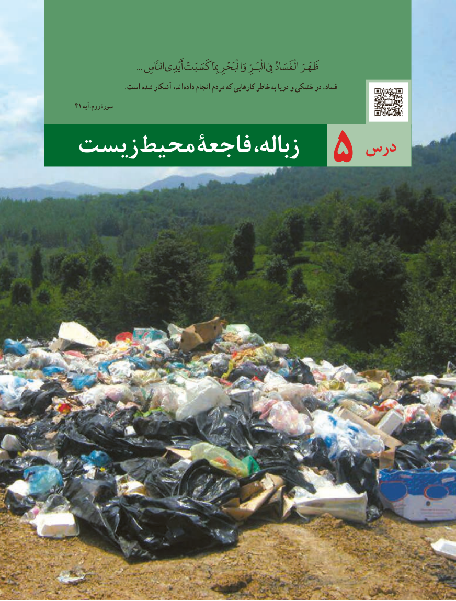

# PDF page 73

... ِظَهَرَانلَّاس أَيْدِی كَسَبَتْ مِبَِا وَابْلَْحْرِ ابْلَْـرِّ یِفِ الْفَسَادُ
  . است شده آشکار اند، داده انجام مردم که کارهایی خاطر به دریا و خشکی در فساد،
41 روم،آیه سورۀ

                           درسزیست محیط فاجعۀ ،زباله            5

                               6565

