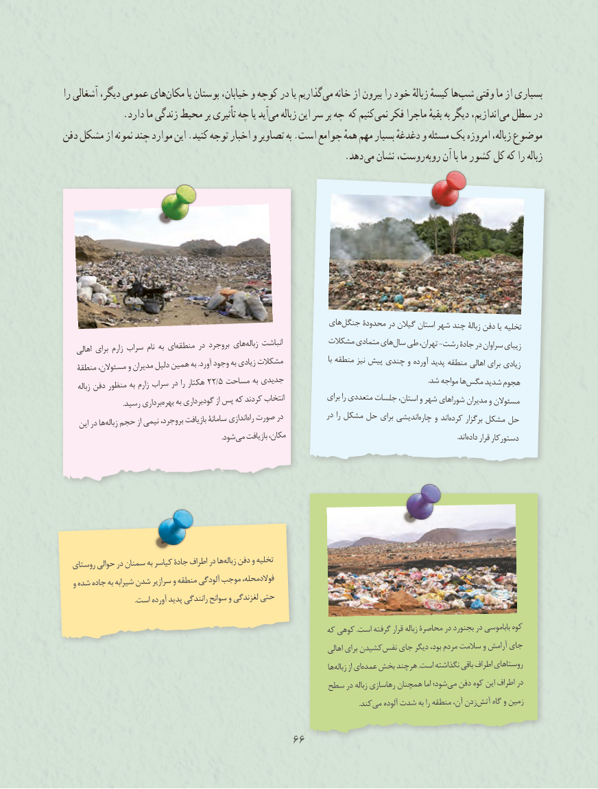

# PDF page 74

را آشغالی دیگر، عمومی هایمکان‏       یا بوستان خیابان، و کوچه در یا گذاریممی‏   خانه از بیرون را خود زبالهٔ کیسهٔ هاشب‏   وقتی ما از بسیاری
 .‏دارد ما زندگی محیط بر تأثیری چه یا آیدمی زباله این سر بر چه که کنیمنمی‏   فکر ماجرا بقیهٔ به دیگر اندازیم،می‏  سطل در
دفن مشکل از نمونه چند موارد این .کنید توجه اخبار و تصاویر به .است جوامع همهٔ مهم بسیار دغدغهٔ و مسئله یک امروزه زباله، موضوع
                          . دهد می نشان روست، روبه آن با ما کشور کل که را زباله

                                                            هایجنگل‏    محدودة در گیالن استان شهر چند زبالة دفن یا تخلیه
                                                                                                            جادة در سراوان زیبای    اهالی برای زارم سراب نام به ایمنطقه‏     در بروجرد هایزباله‏    انباشت          مشکالت متمادی هایسال‏  طی تهران، -رشت
                                                                                                منطقه اهالی برای زیادی   منطقة مسئوالن، و مدیران دلیل همین به .آورد وجود‏به زیادی مشکالت                    با منطقه نیز پیش چندی و آورده پدید
     زباله دفن منظور به زارم سراب در را هکتار 22/5 مساحت به جدیدی       .‏شد مواجه هامگس شدید هجوم
                                                                                                                   مدیران و مسئوالن   .‏رسید برداریبهره به گودبرداری از پس که کردند انتخاب            برای را متعددی جلسات استان، و شهر شوراهای
                                                                                                                                      کرده برگزار مشکل حل    این در هازباله‏  حجم از نیمی بروجرد، بازیافت سامانة اندازیراه‏ صورت در            در را مشکل حل برای اندیشیچاره‏    و اند
                  .‏شودمی بازیافت مکان،                            .‏اندداده قرار دستورکار

  روستای حوالی در سمنان به کیاسر جادة اطراف در هازباله‏   دفن و تخلیه
  و شده جاده به شیرابه شدن سرازیر و منطقه آلودگی موجب فوالدمحله،
                                  .است آورده پدید رانندگی سوانح و لغزندگی حتی

                                                               که کوهی .است گرفته قرار زباله محاصرة در بجنورد در باباموسی کوه
                                                                                    اهالی برای کشیدننفس‏   جای دیگر بود، مردم سالمت و آرامش جای
                                                                              هازباله‏     از ایعمده‏  بخش هرچند .است نگذاشته باقی اطراف روستاهای
                                                سطح در زباله رهاسازی همچنان اما شود؛می‏  دفن کوه این اطراف در
                                     . کندمی آلوده شدت به را منطقه آن، زدنآتش‏    گاه و زمین

                                      6666

