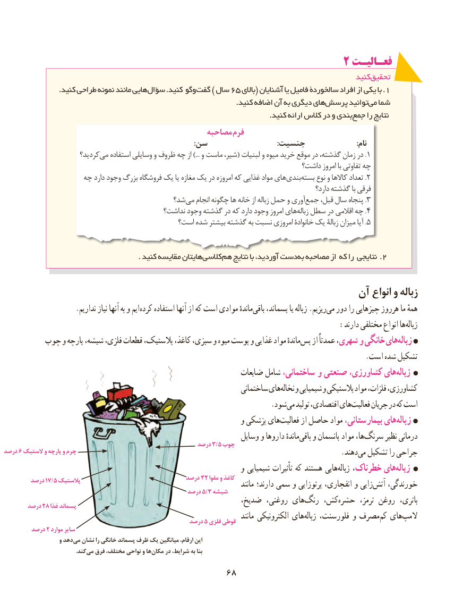

# PDF page 76

2 فعـالیـت
                                                                                               کنید تحقیق
                       .کنید طراحی نمونه مانند هایی سؤال .کنید وگو گفت ) سال 65 باالی( آشنایان یا فامیل سالخوردة افراد از یکی با .1
                                                                                                 .کنید اضافه آن به دیگری هایپرسش‏       توانیدمی‏  شما
      .‏کنید ارائه کالس در و بندیجمع را نتایج
                                                مصاحبه فرم
                                                                                                   :سن                                    :جنسیت                           :نام
                       کردید؟می‏.استفاده وسایلی و ظروف چه از ...) و ماست شیر،( لبنیات و میوه خرید موقع در گذشته، زمان در 1
                                                                            داشت؟ امروز با تفاوتی چه
                  چه دارد وجود بزرگ فروشگاه یک یا مغازه یک در امروزه که غذایی مواد هایبندی‏   بسته‏.نوع و کاالها تعداد 2
                                                                                                               دارد؟ گذشته با فرقی
                                         شد؟می‏   انجام چگونه ها خانه از زباله حمل و آوریجمع‏.قبل، سال پنجاه 3
                                            نداشت؟ وجود گذشته در که دارد وجود امروز هایزباله‏.سطل در اقالمی چه 4
                                           است؟ شده بیشتر گذشته به نسبت امروزی خانوادة یک زبالة میزان آیا . 5

                                                        . کنید مقایسه هایتانکالسی‏          هم نتایج با آوردید، دستبه‏.مصاحبه از که را نتایجی 2

                                                             آن انواع و زباله
  . نداریم نیاز آنها به و ایم کرده استفاده آنها از که است موادی ماندهٔباقی‏    پسماند، یا زباله .ریزیممی‏  دور را چیزهایی هرروز ما همهٔ
          :‏دارند مختلفی انواع هازباله
        چوب و پارچه شیشه، فلزی، قطعات پالستیک، کاغذ، سبزی، و میوه پوست و غذایی مواد ماندهٔپس‏   از عمدتاً شهری، و خانگی هایزباله‏
                                                                                                 .است شده تشکیل
                                                                ضایعات شامل ساختمانی، و صنعتی کشاورزی، هایزباله‏
                                                                     ساختمانی هاینخاله‏   و شیمیایی و پالستیکی مواد فلزات، کشاورزی،
                              . شودمی تولید اقتصادی، هایفعالیت‏     جریان در که است
                                                                و پزشکی هایفعالیت‏      از حاصل مواد بیمارستانی، هایزباله‏
                                                                  وسایل و داروها ماندهٔباقی‏   و پانسمان مواد ها،سرنگ‏      نظیر درمانی                                                        درصد ۳/۵ چوب
درصد ۶ الستیک و پارچه و چرم                                                                                           .دهندمی‏  تشکیل را جراحی
                                                                و شیمیایی تأثیرات که هستند هاییزباله‏   خطرناک، هایزباله‏
                                                    درصد 23 مقوا و کاغذ
        درصد ۱۷/۵ پالستیک                                                             مانند دارند؛ سمی و پرتوزایی انفجاری، و زاییآتش‏   خورندگی،                                                     درصد ۵/۳ شیشه
                                                         ضدیخ، روغنی، هایرنگ‏      ،کش‏  حشره‏       ترمز، روغن  باتری،       درصد 28 غذا پسماند
                                                                                          مانند الکترونیکی هایزباله‏    فلورسنت، و مصرفکم‏  هایالمپ‏                                                     درصد 5 فلزی قوطی
        درصد 2 موارد سایر
                    و دهدمی‏  نشان را خانگی پسماند ظرف یک میانگین ،ارقام این
            .‏کندمی فرق ،مختلف نواحی و هامکان‏    در ،شرایط به بنا

                                            6868

