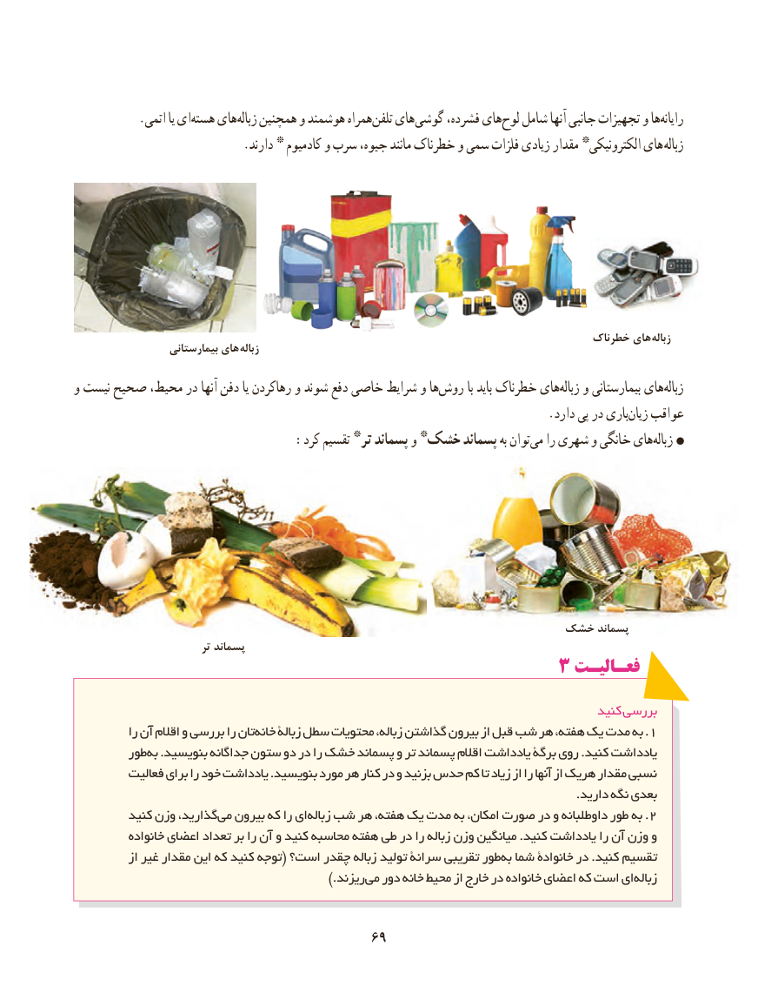

# PDF page 77

.‏اتمی یا ایهسته هایزباله‏   همچنین و هوشمند همراهتلفن‏   هایگوشی‏     فشرده، هایلوح‏   شامل آنها جانبی تجهیزات و هارایانه‏
 . دارند * کادمیوم و سرب جیوه، مانند خطرناک و سمی فلزات زیادی مقدار *الکترونیکی های زباله

                                                                                   خطرناک های  زباله                   بیمارستانی های زباله
و نیست صحیح محیط، در آنها دفن یا رهاکردن و شوند دفع خاصی شرایط و هاروش‏        با باید خطرناک هایزباله‏   و بیمارستانی هایزباله‏
           .‏دارد پی در باریزیان عواقب
  :‏کرد تقسیم *تر پسماند و *خشک پسماند به توانمی را شهری و خانگی هایزباله‏

                                                  خشک پسماند
                           تر پسماند
                                         3 فعـالیـت

                                                                                      کنید بررسی
           را آن اقالم و بررسی را تانخانه‏.زبالة سطل محتویات زباله، گذاشتن بیرون از قبل شب هر هفته، یک مدت به 1
         طوربه‌  .بنویسید جداگانه ستون دو در را خشک پسماند و تر پسماند اقالم یادداشت برگۀ روی .کنید یادداشت
         فعالیت برای را خود یادداشت .بنویسید مورد هر کنار در و بزنید حدس کم تا زیاد از را آنها از هریک مقدار نسبی
                                                                                                                               .دارید نگه بعدی
         کنید وزن گذارید،می‏  بیرون که را ایزباله‏.شب هر هفته، یک مدت به امکان، صورت در و داوطلبانه طور به 2
           خانواده اعضای تعداد بر را آن و کنید محاسبه هفته طی در را زباله وزن میانگین .کنید یادداشت را آن وزن و
           از غیر مقدار این که کنید توجه( است؟ چقدر زباله تولید سرانة تقریبی طوربه‌  شما خانوادة در .کنید تقسیم
                   .)‏ریزندمی دور خانه محیط از خارج در خانواده اعضای که است ایزباله‏

                                       6969

