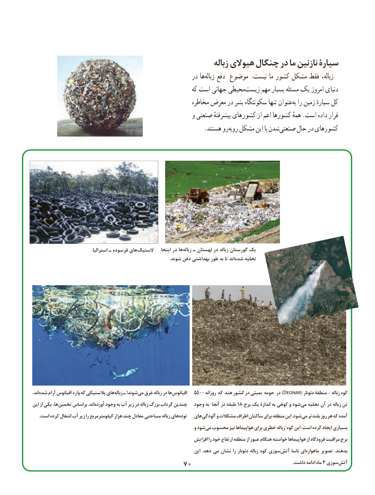

# PDF page 78

زباله هیوالی چنگال در ما نازنین سیارة
                                                       در هازباله‏    دفع موضوع .نیست ما کشور مشکل فقط زباله،
                                                            که است جهانی محیطیزیست‏     مهم بسیار مسئله یک امروز دنیای
                                                        مخاطره معرض در بشر سکونتگاه تنها عنوانبه‌ را زمین سیارهٔ کل
                                                     و صنعتی پیشرفتهٔ کشورهای از اعم کشورها همهٔ .است داده قرار
             .‏هستند روروبه مشکل این با شدنصنعتی‏     حال در کشورهای

                                استرالیا ـ فرسوده هایالستیک‏            اینجا در هازباله‏   ـ لهستان در زباله گورستان یک
    .‏شوند دفن بهداشتی طور به تا اندشده تخلیه

اند،شده‏    آرام اقیانوس وارد که پالستیکی هایزباله‏   ـ !شوند می غرق زباله در ها اقیانوس   5500 روزانه که هند کشور در بمبئی حومه در )Deonar( دئونار منطقة - زباله کوه
این از یکی ها،تخمین‏     براساس .اندآورده‏    وجود به آب زیر در زباله بزرگ گرداب چندین   وجود به آنجا در طبقه 18 برج یک اندازة به کوهی و شودمی‏  تخلیه آن در زباله تن
.‏است کرده اشغال آب زیر را کیلومترمربع هزار چند معادل مساحتی زباله هایتوده   هایآلودگی‏      و مشکالت اطراف ساکنان برای منطقه این .شودمی‏   بلندتر روز هر که آمده
                                                                         و شودمی‏  محسوب نیز هواپیماها برای خطری زباله کوه این .است کرده ایجاد بسیاری
                                                                       افزایش را خود ارتفاع منطقه از عبور هنگام خواسته هواپیماها از فرودگاه مراقبت برج
                                                                            این .دهد می نشان را دئونار زباله کوه سوزیآتش‏     ناسا ایماهواره‏      تصویر .بدهند
                                                                       7070      .3داشت ادامه ماه  سوزیآتش‏

