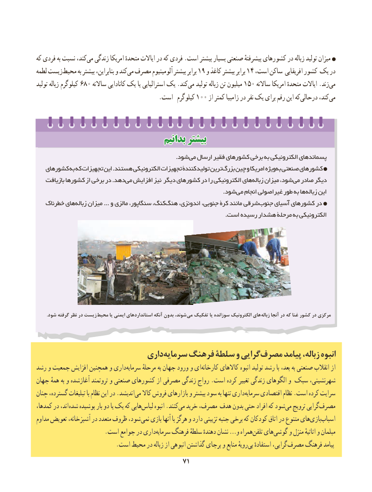

# PDF page 79

که فردی به نسبت کند،می‏  زندگی امریکا متحدهٔ ایاالت در که فردی .است بیشتر بسیار صنعتی پیشرفتهٔ کشورهای در زباله تولید میزان
لطمه زیستمحیط‏       به بیشتر بنابراین، و کندمی‏ مصرف آلومینیوم بیشتر برابر 19 و کاغذ بیشتر برابر 14 ،دراست ساکن افریقایی کشور یک
تولید زباله کیلوگرم 680 ساالنه کانادایی یک یا استرالیایی یک .کندمی‏   تولید زباله تن میلیون 150 ساالنه امریکا متحدهٔ ایاالت .زندمی‏
          .100است  کیلوگرم      از کمتر زامبیا در نفر یک برای رقم این کهدرحالی‌       کند،می‏

                                    بدانیمبدانیم بیشتربیشتر
                                                                        .شود می ارسال فقیر کشورهای برخی به الکترونیکی پسماندهای
   کشورهای به که تجهیزات این .هستند الکترونیکی تجهیزات تولیدکنندة ترینبزرگ‌   چین و امریکا ویژهبه‏ صنعتی کشورهای
   بازیافت کشورها از برخی در .دهدمی‏  افزایش نیز دیگر کشورهای در را الکترونیکی هایزباله‏    میزان شود، می صادر دیگر
                          . شودمی انجام غیراصولی طور به ها زباله این
   خطرناک هایزباله‏    میزان ... و مالزی سنگاپور، کنگ،هنگ‏    اندونزی، جنوبی، کرة مانند شرقیجنوب‏    آسیای کشورهای در
                                                                                                  .است رسیده هشدار مرحلة به الکترونیکی

         .شود گرفته نظر در زیست محیط یا ایمنی استانداردهای آنکه بدون شوند، می تفکیک یا سوزانده الکترونیک های زباله آنجا در که غنا کشور در مرکزی

                           داریسرمایه‏    فرهنگ سلطة و گراییمصرف‏      پیامد ،زباله انبوه
رشد و جمعیت افزایش همچنین و داریسرمایه‏      مرحلهٔ به جهان ورود و ایکارخانه‏      کاالهای انبوه تولید رشد با بعد، به صنعتی انقالب از
جهان همهٔ به و آغازشده ثروتمند و صنعتی کشورهای از مصرفی زندگی رواج .است کرده تغییر زندگی الگوهای و سبک شهرنشینی،
چنان‏،اندیشدگسترده تبلیغات با نظام این در .     می‏   کاال فروش بازارهای و بیشتر سود به تنها داریسرمایه‏     اقتصادی نظام .است کرده سرایت
کمدها، در اند، شده پوشیده بار دو یا یک که هاییلباس‏     انبوه .کنندمی‏  خرید مصرف، هدف بدون حتی افراد که شودمی‏  ترویج گراییمصرف‏
مداوم تعویض آشپزخانه، در متعدد ظروف شود، نمی بازی آنها با هرگز و دارد تزیینی جنبه برخی که کودکان اتاق در متنوع هایبازی‏   اسباب‏
   .‏است جوامع در داریسرمایه فرهنگ سلطهٔ دهندهٔ نشان …و همراهتلفن‏   هایگوشی‏     و منزل اثاثیهٔ و مبلمان
 .‏است محیط در زباله از انبوهی گذاشتن برجای و منابع رویهٔبی استفادهٔ گرایی، مصرف فرهنگ پیامد
                                                                                     7171

