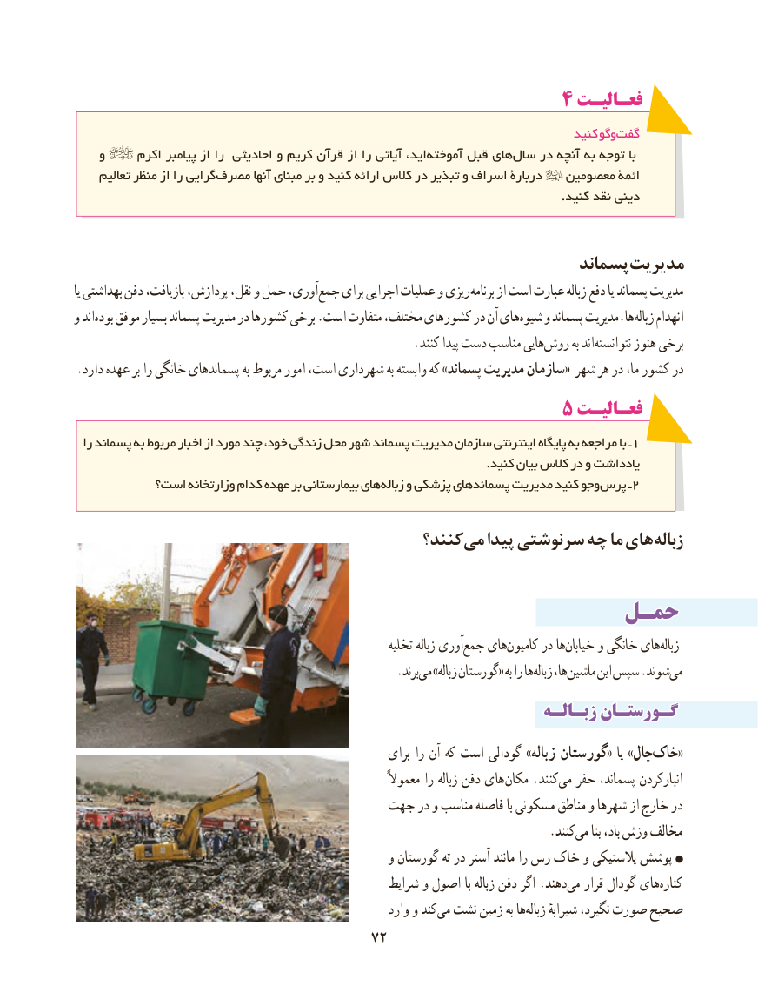

# PDF page 80

4 فعـالیـت
                                                                                   کنید وگوگفت‏
    و     اکرم پیامبر از را احادیثی و کریم قرآن از را آیاتی اید، ‏آموخته قبل های‏سال در آنچه به توجه با
     تعالیم منظر از را گرایی‏مصرف آنها مبنای بر و کنید ارائه کالس در تبذیر و اسراف دربارة   معصومین ائمة
                                                                                                                            .کنید نقد دینی

                                                            پسماندمدیریت
یا بهداشتی دفن بازیافت، پردازش، نقل، و حمل آوری،جمع‏    برای اجرایی عملیات و ریزی برنامه از است عبارت زباله دفع یا پسماند مدیریت
و اندبوده‏   موفق بسیار پسماند مدیریت در کشورها برخی .است متفاوت مختلف، کشورهای در آن هایشیوه‏    و پسماند مدیریت.هازباله‏    انهدام
     .‏کنند پیدا دست مناسب هاییروش به اندنتوانسته‏      هنوز برخی
.دارد عهده بر را خانگی پسماندهای به مربوط امور است، شهرداری به وابسته که »پسماند مدیریت سازمان« شهر هر در ما، کشور در
                                             5 فعـالیـتفعـالیـت
  را پسماند به مربوط اخبار از مورد چند خود، زندگی محل شهر پسماند مدیریت سازمان اینترنتی پایگاه به مراجعه با ـ 1
                                                                                                         .کنید بیان کالس در و یادداشت
          است؟ وزارتخانه کدام عهده بر بیمارستانی های زباله و پزشکی پسماندهای مدیریت کنید وجو پرس ـ2

                                          کنند؟می‏   پیدا سرنوشتی چه ما های زباله

                                        حمـلحمـل
                                                               تخلیه زباله آوریجمع‏   هایکامیون‏     در هاخیابان‏     و خانگی هایزباله‏
                         .‏برندمی »زباله گورستان« به را هازباله‏    ها،ماشین‏     این سپس .شوندمی‏
                                                              زبـالـهزبـالـه گـورستـانگـورستـان
                                                          برای را آن که است گودالی »زباله گورستان« یا »چالخاک‌«
                                                                     معموالً را زباله دفن های مکان .کنندمی‏  حفر پسماند، انبارکردن
                                   جهت در و مناسب فاصله با مسکونی مناطق و شهرها از خارج در
                                 .‏کنندمی بنا باد، وزش مخالف
                                                    و گورستان ته در آستر مانند را رس خاک و پالستیکی پوشش
                                                   شرایط و اصول با زباله دفن اگر .دهندمی‏   قرار گودال هایکناره‏
                                                            وارد و کندمی‏  نشت زمین به هازباله‏     شیرابهٔ نگیرد، صورت صحیح
                                                                         7272

