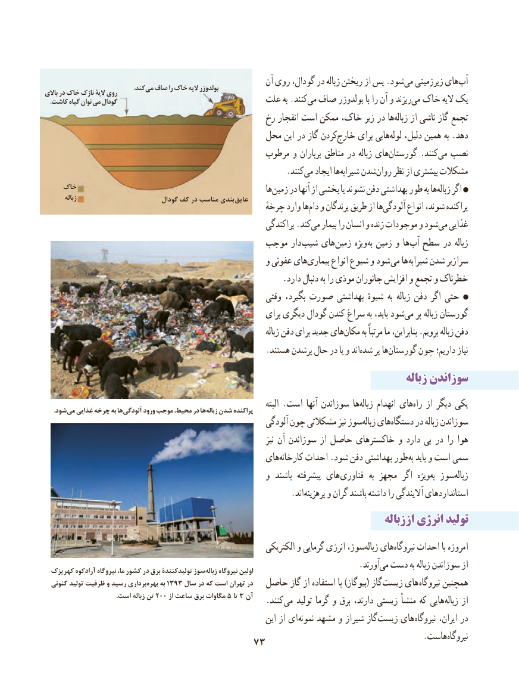

# PDF page 81

آن روی گودال، در زباله ریختن از پس .شودمی‏  زیرزمینی هایآب‏             . کندمی صاف را خاک الیه بولدوزرباالی در خاک نازک الیۀ روی. کاشت گیاه توانمی گودال                              علت به .کنندمی‏ صاف بولدوزر با را آن و ریزندمی‏ خاک الیه یک
                                              رخ انفجار است ممکن خاک، زیر در هازباله‏    از ناشی گاز تجمع
                                          محل این در گاز کردنخارج‏     برای هاییلوله‏   دلیل، همین به .دهد
                                               مرطوب و پرباران مناطق در زباله هایگورستان‏       .کنندمی‏  نصب
                        .‏کنندمی ایجاد هاشیرابه‏    شدنروان‏    نظر از بیشتری مشکالت
    خاک                                                         هازمین‏    در آنها از بخشی یا نشوند دفن بهداشتی طور به هازباله‏    اگر        زباله                          گودال کف در مناسب بندی  عایق
               ٔهاچرخه وارد  دام‏  و پرندگان طریق از هاآلودگی‏      انواع شوند، پراکنده
                                                             پراکندگی .کندمی‏   بیمار را انسان و زنده موجودات و شودمی‏  غذایی
                                        موجب دار شیب های زمین ویژه به زمین و ها آب سطح در زباله
                                                     و عفونی هایبیماری‏      انواع شیوع و شود می ها شیرابه شدن سرازیر
                                                         .دارد دنبال به را موذی جانوران افزایش و تجمع و خطرناک
                                                         وقتی بگیرد، صورت بهداشتی شیوهٔ به زباله دفن اگر حتی
                                                           برای دیگری گودال کندن سراغ به باید، شودمی‏   پر زباله گورستان
                                                                                 زباله دفن برای جدید هایمکان‏      به مرتباً ما بنابراین، .برویم زباله دفن
     .‌هستند پرشدن حال در یا و اندشده پر هاگورستان‏     چون داریم؛ نیاز
                                                                                     زبالهزباله سوزاندنسوزاندن
                                                                                    البته .است آنها سوزاندن هازباله‏     انهدام هایراه‏   از دیگر یکی . شودمی غذایی چرخه به ها آلودگی ورود موجب محیط، در ها زباله شدن پراکنده
                                                           آلودگی چون مشکالتی نیز سوززباله‏   هایدستگاه‏     در زباله سوزاندن
                                                                                 نیز آن سوزاندن از حاصل خاکسترهای و دارد پی در را هوا
                                                 هایکارخانه‏     احداث .شود دفن بهداشتی طور به باید و است سمی
                                                     و  باشند پیشرفته های فناوری  به مجهز  اگر  ویژهبه‏  سوززباله‏
                                 . اند پرهزینه و گران باشند داشته را آالیندگی استانداردهای
                                                                                اززبالهاززباله انرژیانرژی تولیدتولید
                                                             الکتریکی و گرمایی انرژی سوز،زباله‏   هاینیروگاه‏     احداث با امروزه
                           .‏آورندمی دست به زباله سوزاندن از  کهریزک آرادکوه نیروگاه ما، کشور در برق تولیدکنندة سوززباله‏    نیروگاه اولین
  کنونی تولید ظرفیت و رسید برداری ‏بهره به 1393 سال در که است تهران در  حاصل گاز از استفاده با )بیوگاز( گاز زیست های نیروگاه همچنین
      .200است زباله تن      از ساعت برق مگاوات 5 تا 3 آن   .کنند می تولید گرما و برق دارند، زیستی منشأ که هایی زباله از
                                                                 این از ای نمونه مشهد و شیراز گاز زیست های نیروگاه ایران، در
                                                                                           .هاست نیروگاه                                                                      7373

