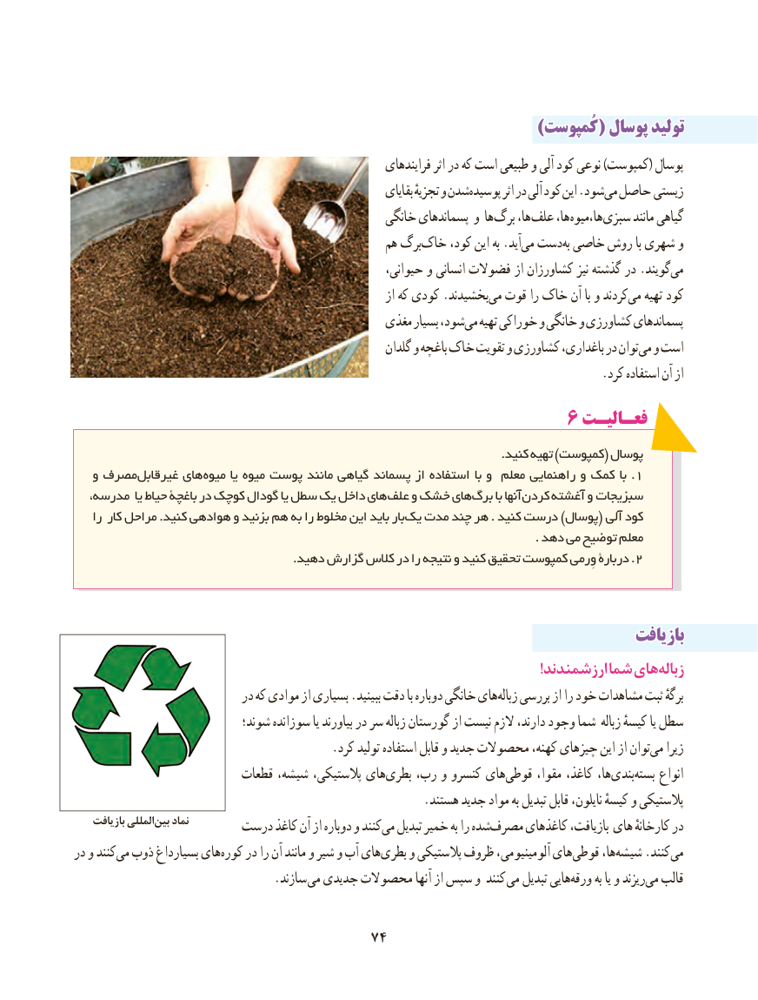

# PDF page 82

))کُمپوستکُمپوست(( پوسالپوسال تولیدتولید
                                                             فرایندهای اثر در که است طبیعی و آلی کود نوعی )کمپوست( پوسال
                                                                   بقایای تجزیهٔ و شدنپوسیده‌       اثر در آلی کود این .شودمی‏ حاصل زیستی
                                                  خانگی پسماندهای و ها برگ ها، علف ها، ها،میوه سبزی مانند گیاهی
                                                   هم برگخاک‌    کود، این به .آیدمی‏  دست ‏به خاصی روش با شهری و
                                                         حیوانی، و انسانی فضوالت از کشاورزان نیز گذشته در .گویندمی‏
                                                                  از که کودی .بخشیدندمی‏  قوت را خاک آن با و کردندمی‏   تهیه کود
                                               مغذی بسیار شود،می‏  تهیه خوراکی و خانگی و کشاورزی پسماندهای
                                                           گلدان و باغچه خاک تقویت و کشاورزی باغداری، در توانمی‏  و است
                                                                                       .کرد استفاده آن از
                                              6 فعـالیـت
                                                                                                            .کنید تهیه )کمپوست( پوسال
   و مصرفغیرقابل‌      هایمیوه‏.یا میوه پوست مانند گیاهی پسماند از استفاده با و معلم راهنمایی و کمک با 1
،هایمدرسه یا حیاط باغچة در کوچک گودال یا سطل یک داخل   علف‏   و خشک هایبرگ‏     با آنها کردن آغشته‏     و سبزیجات
    را کار مراحل .کنید هوادهی و بزنید هم به را مخلوط این باید بار یک مدت چند هر . کنید درست )پوسال( آلی کود
                                                                                                                     . دهد می توضیح معلم
 .2دهید گزارش کالس در را نتیجه و کنید تحقیق کمپوست وِرمی دربارة .

                                                                                 بازیافتبازیافت
                                                                                                                                   !ارزشمندند شما هایزباله‏
                             در که موادی از بسیاری .ببینید دقت با دوباره خانگی هایزباله‏   بررسی از را خود مشاهدات ثبت برگهٔ
                             شوند؛ سوزانده یا بیاورند در سر زباله گورستان از نیست الزم دارند، وجود شما زباله کیسهٔ یا سطل
                                          .کرد تولید استفاده قابل و جدید محصوالت کهنه، چیزهای این از توانمی‏   زیرا
                           قطعات شیشه، پالستیکی، هایبطری‏    رب، و کنسرو هایقوطی‏      مقوا، کاغذ، ها،بندی‏    بسته‏    انواع
                                                          .هستند جدید مواد به تبدیل قابل نایلون، کیسهٔ و پالستیکی
    بازیافت المللیبین‏   نماد       درست کاغذ آن از دوباره و کنندمی‏  تبدیل خمیر به را شدهمصرف‏     کاغذهای بازیافت، های کارخانهٔ در
در و کنندمی‏  ذوب بسیارداغ هایکوره‏    در را آن مانند و شیر و آب هایبطری‏    و پالستیکی ظروف آلومینیومی، هایقوطی‏      ها،شیشه‏    .کنندمی‏
           . سازند می جدیدی محصوالت آنها از سپس و کنند می تبدیل هاییورقه‏     به یا و ریزندمی‏  قالب

                                                                        7474

