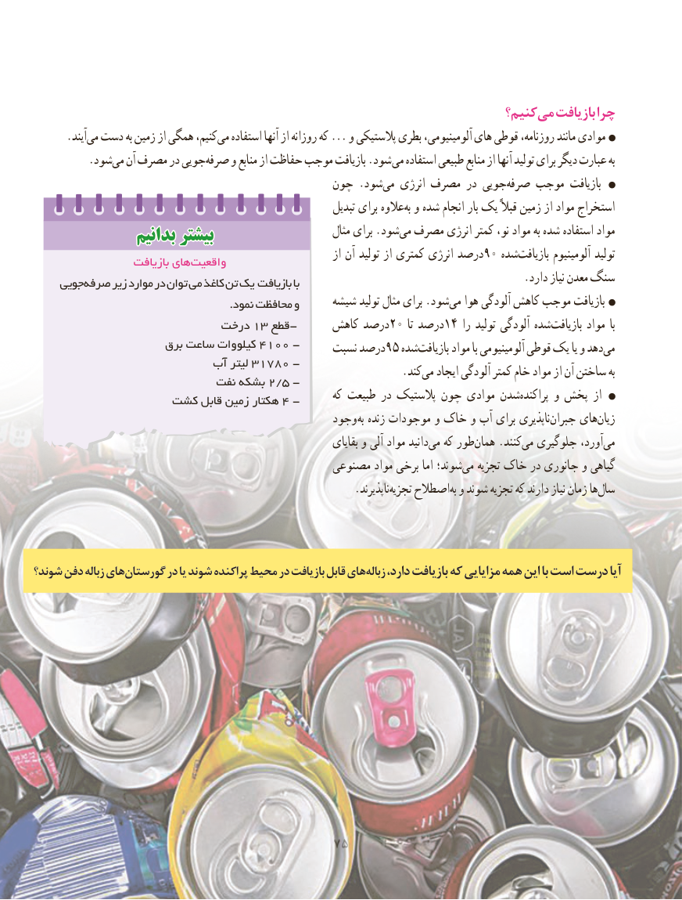

# PDF page 83

کنیم؟می‏  بازیافت چرا
      .آیندمی‏ دست به زمین از همگی کنیم،می‏   استفاده آنها از روزانه که ... و پالستیکی بطری آلومینیومی، های قوطی روزنامه، مانند موادی
          .شودمی‏  آن مصرف در جوییصرفه‏    و منابع از حفاظت موجب بازیافت .شود می استفاده طبیعی منابع از آنها تولید برای دیگر عبارت به
                                            چون .شودمی‏   انرژی مصرف در جوییصرفه‏    موجب بازیافت
                                                                  تبدیل برای عالوهبه‌ و شده انجام بار یک قبالً زمین از مواد استخراج
                بدانیمبدانیم بیشتربیشتر                           مثال برای .شودمی‏  مصرف انرژی کمتر نو، مواد به شده استفاده مواد
                                                                     از آن تولید از کمتری انرژی درصد90 شدهبازیافت‏        آلومینیوم تولید                    بازیافت های‌واقعیت
    جویی صرفه زیر موارد در توان می کاغذ تن یک بازیافت‌          با                                         .دارد نیاز معدن سنگ
                                                       .نمود محافظت و     شیشه تولید مثال برای .شودمی‏  هوا آلودگی کاهش موجب بازیافت
                          درخت 13 قطع-     کاهش درصد20 تا درصد14 را تولید آلودگی شدهبازیافت‏       مواد  با
                      برق ساعت کیلووات 4100 -     نسبت درصد95 شدهبازیافت‏      مواد با آلومینیومی قوطی یک یا و دهدمی‏
                         آب لیتر 31780 -         .‏کندمی ایجاد آلودگی کمتر خام مواد از آن ساختن به                            نفت بشکه 2/5 -
                کشت قابل زمین هکتار 4 -       که طبیعت در پالستیک چون موادی شدنپراکنده‏      و پخش از
                                                 وجود به زنده موجودات و خاک و آب برای ناپذیریجبران‏    هایزیان‏
                                                                       بقایای و آلی مواد دانیدمی‏   که طورهمان‏    .کنندمی‏  جلوگیری آورد،می‏
                                               مصنوعی مواد برخی اما شوند؛می‏   تجزیه خاک در جانوری و گیاهی
                 .‏ناپذیرندتجزیه اصطالحبه‌ و شوند تجزیه که دارند نیاز زمان هاسال‏

شوند؟ دفن زباله های گورستان در یا شوند پراکنده محیط در بازیافت قابل های زباله ،دارد بازیافت که مزایایی همه این با است درست آیا

                                       7575

