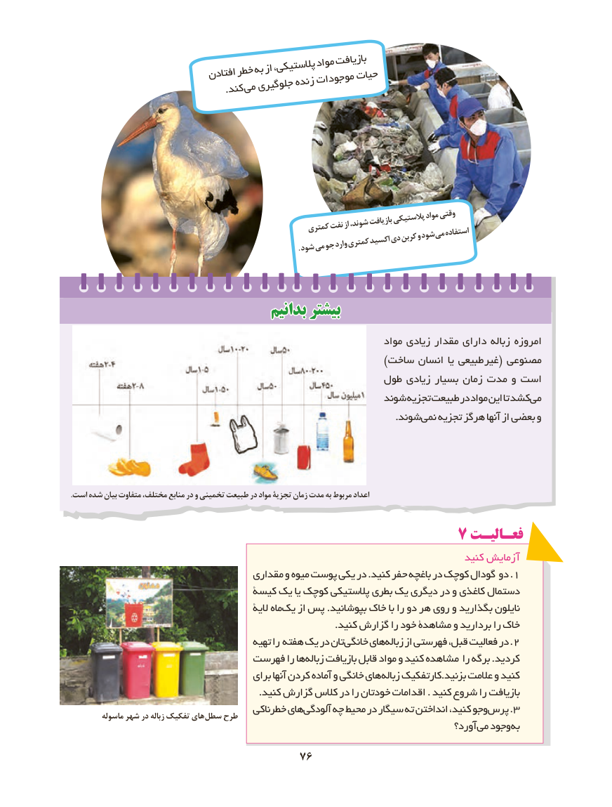

# PDF page 84

موادبازیافت                                          پالستیکی،                            افتادنخطربهاز                                                 حیات                                           زنده موجودات                                   جلوگیری              . کندمی

                                                                                                 موادوقتی                                                                             پالستیکی                                                   کمترینفتازشوند،بازیافت
                                                                           واردکمتریاکسیددیکربنوشودمیاستفاده   . شودمیجو

                                  بدانیمبدانیم بیشتربیشتر
                                                                   مواد زیادی مقدار دارای زباله امروزه
                                                                             )ساخت انسان یا طبیعی غیر( مصنوعی
                                                   طول زیادی بسیار زمان مدت و است
                                                       شوند تجزیه طبیعت در مواد این تا کشدمی‏
                       .‏شوندنمی تجزیه هرگز آنها از بعضی و

.است شده بیان متفاوت ،مختلف منابع در و تخمینی طبیعت در مواد تجزیۀ زمان مدت به مربوط اعداد

                                          7 فعـالیـت
                                                                                 کنید زمایش آ
                                    مقداری و میوه پوست یکی در .کنید حفر باغچه در کوچک گودال دو .1
                               کیسة یک یا کوچک پالستیکی بطری یک دیگری در و کاغذی دستمال
                                                الیة ماهیک‏   از پس .بپوشانید خاک با را دو هر روی و بگذارید نایلون
                                                                                   .کنید گزارش را خود مشاهدة و بردارید را خاک
                                        تهیه را هفته یک در تانخانگی‏    هایزباله‏.از فهرستی قبل، فعالیت در 2
                            فهرست را هازباله‏    بازیافت قابل مواد و کنید مشاهده را برگه .کردید
                                        برای آنها کردن آماده و خانگی های زباله کارتفکیک.بزنید عالمت و کنید
                                                           .کنید گزارش کالس در را خودتان اقدامات . کنید شروع را بازیافت
                                      خطرناکی های آلودگی چه محیط در سیگار ته انداختن کنید، وجو .پرس 3         ماسوله شهر در زباله تفکیک های سطل طرح
                                                                                     آورد؟ می وجود به

                                   7676

