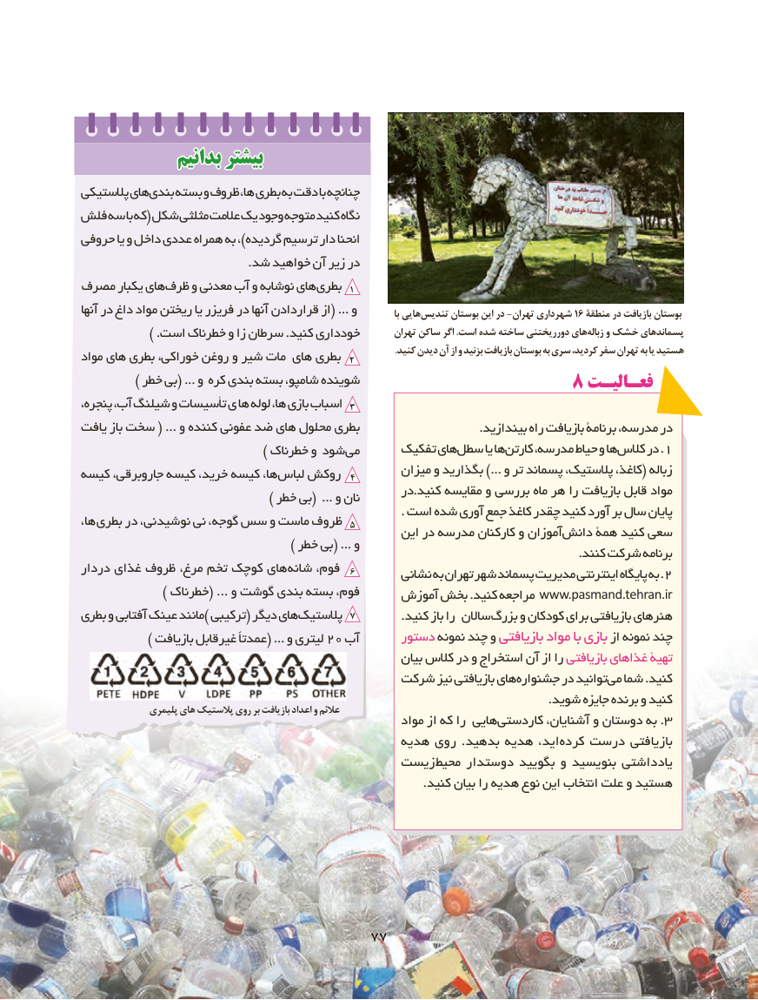

# PDF page 85

بدانیمبدانیم بیشتربیشتر
پالستیکی هایبندی    بسته و ظروف ها، بطری به دقت با چنانچه
فلش سه با که( شکل مثلثی عالمت یک وجود متوجه کنید نگاه
حروفی یا و داخل عددی همراه به ،)گردیده ترسیم دار انحنا
                                          .شد خواهید آن زیر در
مصرف يكبار هاي ظرف و معدني آب و نوشابه های 1بطری
آنها در داغ مواد ريختن يا فريزر در آنها قراردادن از( ... و             با هاییتندیس‌      بوستان این در -تهران شهرداری 16 منطقة در بازیافت بوستان
              ) .است خطرناك و زا سرطان .كنيد خودداري        تهران ساکن اگر .است شده ساخته دورریختنی هایزباله‌    و خشک پسماندهای
                                                                                                                                     .کنید دیدن آن از و بزنید بازیافت بوستان به سری ،کردید سفر تهران به یا هستیدمواد های بطری خوراكي، روغن و شیر مات های بطری  2
           ) خطر بي( ... و كره بندي بسته شامپو، شوينده                                           8 فعـالیـت
پنجره، آب، شیلنگ و تأسيسات ي ها لوله ها، بازي اسباب 3
يافت باز سخت ( ... و كننده عفوني ضد هاي محلول بطري                              .بیندازید راه بازیافت برنامة مدرسه، در
    ) خطرناك و شود مي      تفکیک هایسطل‌      یا هاکارتن‌    مدرسه، حیاط و هاکالس١‌.در
                                                     میزان و بگذارید ...) و تر پسماند پالستیک، کاغذ،( زبالهكيسه ،كيسهجاروبرقي   ،كيسهخريد       ،ها 4لباس روكش
                                                   در.کنید مقایسه و بررسی ماه هر را بازیافت قابل مواد                                     ) خطر بي( ... و نان
                                                                                 . است شده آوری جمع کاغذ چقدر کنید آورد بر سال پایانها، بطري در نوشيدني، نی گوجه، سس و ماست ظروف 5                                                     این در مدرسه کارکنان و آموزاندانش‌    همة کنید سعی
                                          ) خطر بي( ... و                                                                                                                              .کنند شرکت برنامه
دردار غذاي ظروف مرغ، تخم کوچک های شانه فوم،  6                                                    نشانی به تهران شهر پسماند مدیریت اینترنتی پایگاه به .2
                ) خطرناك( ... و گوشت بندي بسته فوم،     آموزش بخش .کنید مراجعه www.pasmand.tehran.ir
بطري و آفتابي عينك مانند) تركيبي( ديگر هاي پالستیک 7            .کنید باز را ساالن بزرگ و کودکان برای بازیافتی هنرهای
             ) بازيافت غيرقابل عمدتاً( ... و ليتري 20 آب      دستور نمونه چند و بازیافتی مواد با بازی‌     از نمونه چند
                                                           بیان کالس در و استخراج آن از را بازیافتی غذاهای تهیۀ
                                      شرکت نیز بازیافتی هایجشنواره‌       در توانیدمی‌  شما .کنید
                                                                                                                       .شوید جایزه برنده و کنید              پلیمری های پالستیک روی بر بازیافت اعداد و عالئم
                                                        مواد از که را هاییکاردستی‌.آشنایان، و دوستان به 3
                                             هدیه روی . بدهید هدیه اید، ‌کرده درست بازیافتی
                                      زیست ‌محیط دوستدار بگویید و بنویسید یادداشتی
                                                                                       .کنید بیان را هدیه نوع این انتخاب علت و هستید

                                  7777

