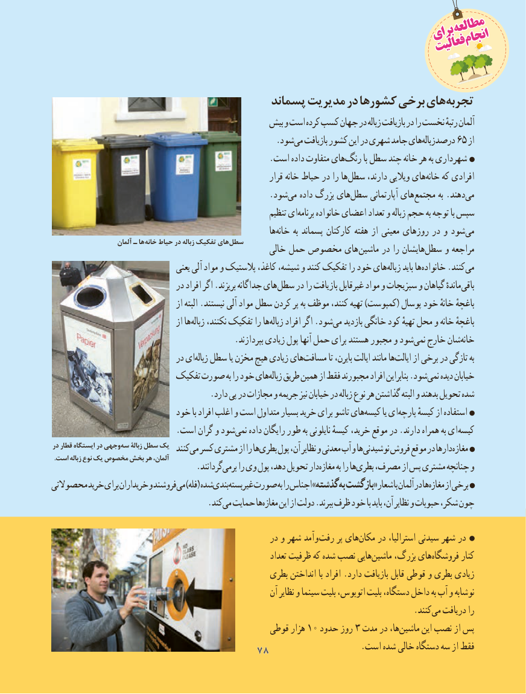

# PDF page 86

مطالعهمطالعه                                                        برایبرای                                                                     انجامانجام                                                               فعالیتفعالیت

                                      پسماند مدیریت در کشورها برخی هایتجربه‏
                                              بیش و است کرده کسب جهان در زباله بازیافت در را نخست رتبهٔ آلمان
                      .‏شودمی بازیافت کشور این در شهری جامد هایزباله‏      درصد 65 از
                                                    .است داده متفاوت هایرنگ‏       با سطل چند خانه هر به شهرداری
                                                                قرار خانه حیاط در را هاسطل‏     دارند، ویالیی هایخانه‏    که افرادی
                                                    .شودمی‏   داده بزرگ هایسطل‏      آپارتمانی هایمجتمع‏        به .دهندمی‏
                                                                تنظیم ایبرنامه‏     خانواده اعضای تعداد و زباله حجم به توجه با سپس
                                                                 هاخانه‏      به پسماند کارکنان هفته از معینی روزهای در و شودمی‏
                      آلمان ـ ها خانه حیاط در زباله تفکیک های سطل      خالی حمل مخصوص های ماشین در را هایشانسطل‏    و مراجعه
                                   یعنی آلی مواد و پالستیک کاغذ، شیشه، و کنند تفکیک را خود هایزباله‏     باید هاخانواده‏      .کنندمی‏
                               در افراد اگر .بریزند جداگانه هایسطل‏    در را بازیافت غیرقابل مواد و سبزیجات و گیاهان ماندهٔباقی‌
                                     از البته .نیستند آلی مواد سطل کردن پر به موظف کنند، تهیه )کمپوست( پوسال خود خانهٔ باغچهٔ
                                     از هازباله‏    نکنند، تفکیک را هازباله‏    افراد اگر .شودمی‏   بازدید خانگی کود تهیهٔ محل و خانه باغچهٔ
  .‏بپردازند زیادی پول آنها حمل برای هستند مجبور و شودنمی خارج شانخانه‏
                               در ایزباله‏  سطل یا مخزن هیچ زیادی هایمسافت‏          تا بایرن، ایالت مانند هاایالت‏     از برخی در تازگی به
                         تفکیک صورت به را خود هایزباله‏   طریق همین از فقط مجبورند افراد بنابراین .شودنمی‏   دیده خیابان
                                      .دارد پی در مجازات و جریمه نیز خیابان در زباله نوع هر گذاشتن البته و بدهند تحویل شده‏
                         خود با افراد اغلب و است متداول بسیار خرید برای تاشو هایکیسه‏       یا ایپارچه‏     کیسهٔ از استفاده
                              .است گران و شودنمی‏   داده رایگان طور به نایلونی کیسهٔ خرید، موقع در .دارند همراه به ای کیسه
در قطار ایستگاه در وجهی سه زبالۀ سطل یک  کنندمی‏  کسر مشتری از را هابطری‏    پول آن، نظایر و معدنی آب و هانوشیدنی‏     فروش موقع در دارها مغازه  .است زباله نوع یک مخصوص بخش هر ،آلمان
                                  .گردانندبرمی‏    را وی پول دهد، تحویل دارمغازه‏      به را هابطری‏   مصرف، از پس مشتری چنانچه و
محصوالتی خرید برای خریداران و فروشندمی‏  )فله( شدهبندی‏    غیربسته‏    صورت به را اجناس »گذشته به بازگشت« شعار با آلمان در هامغازه‏    از برخی
                                     .کندمی‏  حمایت هامغازه‏    این از دولت .ببرند ظرف خود با باید آن، نظایر و حبوبات شکر، چون

                                                      در و شهر آمد و رفت پر هایمکان‏    در استرالیا، سیدنی شهر در
                                                                  تعداد ظرفیت که شده نصب هاییماشین‏     بزرگ، هایفروشگاه‏        کنار
                                                بطری انداختن با افراد .دارد بازیافت قابل قوطی و بطری زیادی
                                                          آن نظایر و سینما بلیت اتوبوس، بلیت دستگاه، داخل به آب و نوشابه
                                    .‏کنندمی دریافت را
                                               قوطی هزار 10 حدود روز 3 مدت در ها،ماشین‏      این نصب از پس
                                                                         .است شده خالی دستگاه سه از فقط                                  7878

