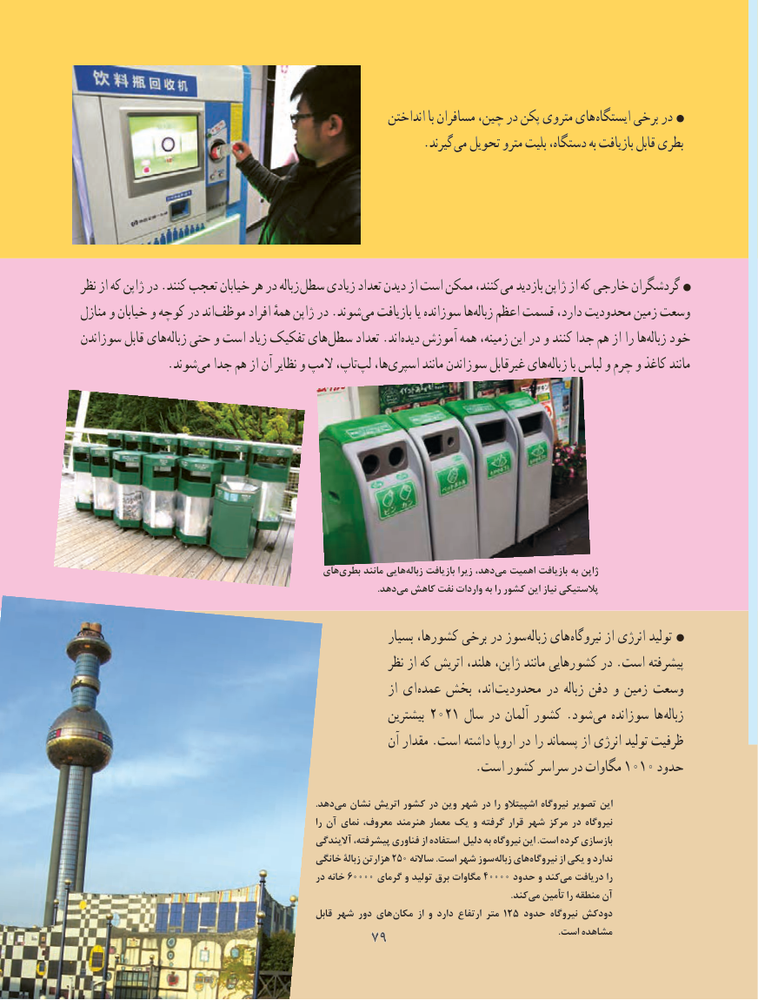

# PDF page 87

انداختن با مسافران چین، در پکن متروی های ایستگاه برخی در
                                                        .گیرند می تحویل مترو بلیت دستگاه، به بازیافت قابل بطری

نظر از که ژاپن در .کنند تعجب خیابان هر در زباله سطل زیادی تعداد دیدن از است ممکن کنند، می بازدید ژاپن از که خارجی گردشگران
منازل و خیابان و کوچه در اندموظف‌       افراد همهٔ ژاپن در .شوندمی‏   بازیافت یا سوزانده هازباله‏   اعظم قسمت دارد، محدودیت زمین وسعت
سوزاندن قابل هایزباله‏   حتی و است زیاد تفکیک هایسطل‏     تعداد .انددیده‏   آموزش‏      همه زمینه، این در و کنند جدا هم از را هازباله‏   خود
     .‏شوندمی جدا هم از آن نظایر و المپ تاپ،لپ‏   ها،اسپری‏       مانند سوزاندن غیرقابل هایزباله‏      با لباس و چرم و کاغذ مانند

                                             هایبطری‌     مانند هاییزباله‌    بازیافت زیرا ،دهدمی‌  اهمیت بازیافت به ژاپن
                            .‌دهدمی کاهش نفت واردات به را کشور این نیاز پالستیکی

                                                             بسیار کشورها، برخی در سوز زباله های نیروگاه از انرژی تولید
                                                           نظر از که اتریش هلند، ژاپن، مانند کشورهایی در .است پیشرفته
                                                                از ای عمده بخش اند، محدودیت در زباله دفن و زمین وسعت
                                                           بيشترين 2021 سال در آلمان كشور .شود می سوزانده ها زباله
                                                        آن مقدار .است داشته اروپا در را پسماند از انرژی توليد ظرفيت
                                                                 .است كشور سراسر در مگاوات 1010 حدود

                                                                                                   .دهدمی‏  نشان اتریش کشور در وین شهر در را اشپیتالو نیروگاه تصویر این
                                                                       را آن نمای ،معروف هنرمند معمار یک و گرفته قرار شهر مرکز در نیروگاه
                                                    آالیندگی ،پیشرفته فناوری از استفاده دلیل به نیروگاه این .است کرده بازسازی
                                             خانگی زبالة هزارتن 250 ساالنه .است شهر سوززباله‏   هاینیروگاه‏        از یکی و ندارد
                                                  در خانه 60000 گرمای و تولید برق مگاوات 40000 حدود و کندمی‏   دریافت را
                                           .‏کندمی تأمین را منطقه آن
                                                        قابل شهر دور های مکان از و دارد ارتفاع متر 215 حدود نیروگاه دودکش
                                    7979                                                                        .است مشاهده

