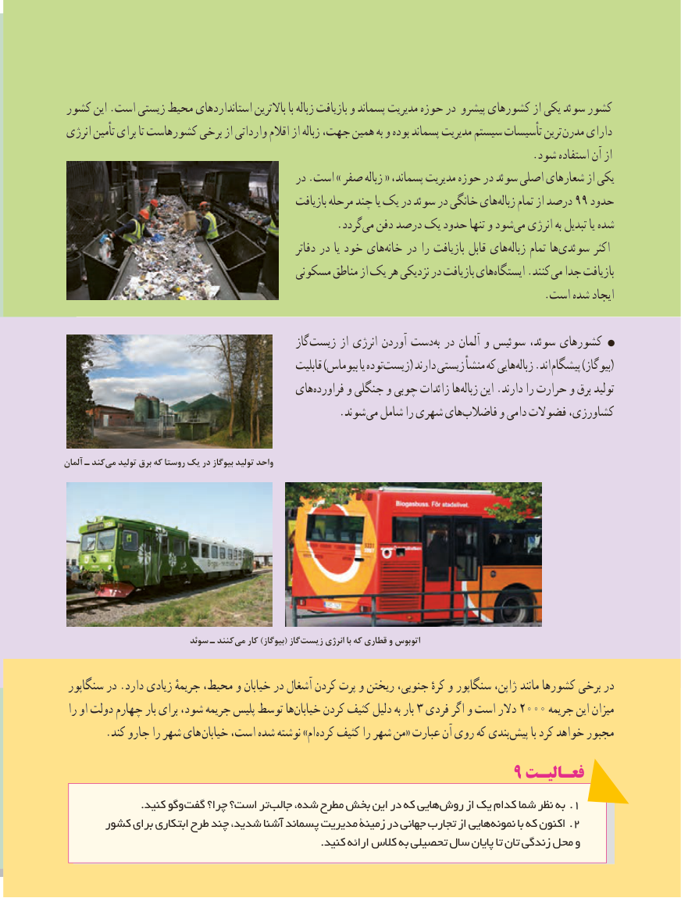

# PDF page 88

کشور این .است زیستی محیط استانداردهای باالترین با زباله بازیافت و پسماند مدیریت حوزه در پیشرو کشورهای از یکی سوئد كشور
 انرژی تأمین برای تا کشورهاست برخی از وارداتی اقالم از زباله جهت، همین به و بوده پسماند مدیریت سیستم تأسیسات ترین مدرن دارای
                                                                                      .شود استفاده آن از
                                            در .است » صفر زباله « پسماند، مدیریت حوزه در سوئد اصلی شعارهای از یکی
                                                    بازیافت مرحله چند یا یک در سوئد در خانگی هایزباله‌    تمام از درصد 99 حدود
                                                  .گرددمی‌  دفن درصد یک حدود تنها و شودمی​  انرژی به تبدیل یا شده
                                                          دفاتر در یا خود هایخانه‌    در را بازیافت قابل هایزباله‌     تمام هاسوئدی‌        اکثر
                                       مسکونی مناطق از یک هر نزدیکی در بازیافت هایایستگاه‌      .کنند می جدا بازیافت
                                                                                        .است شده ایجاد

                                                   گاز زیست از انرژی آوردن دستبه‏ در آلمان و سوئیس سوئد، کشورهای
                                                    قابلیت )بیوماس یا تودهزیست‏      ( دارند زیستی منشأ که هاییزباله‏   .اند (پیشگام )بیوگاز
                                       هایفراورده‏      و جنگلی و چوبی زائدات هازباله‏    این .دارند را حرارت و برق تولید
                   . شوند می شامل را شهری هایفاضالب‏      و دامی فضوالت کشاورزی،

آلمان ـ کندمی‏   تولید برق که روستا یک در بیوگاز تولید واحد

                           سوئد ـ کنند می کار )(بیوگاز گاز زیست انرژی با که قطاری و اتوبوس

 سنگاپور در .دارد زیادی جریمهٔ محیط، و خیابان در آشغال کردن پرت‏   و ریختن جنوبی، کرهٔ و سنگاپور ژاپن، مانند کشورها برخی در
 را او دولت چهارم بار برای شود، جریمه پلیس توسط هاخیابان​     کردن کثیف دلیل به بار ٣ فردی اگر و است دالر ٢000 جریمه این میزان
 . کند جارو را شهر های خیابان است، شده نوشته »ام کرده کثیف را شهر من« عبارت آن روی که بندی پیش با کرد خواهد مجبور
                                                        9 فعـالیـت
   . کنید وگوگفت چرا؟ است؟ تر جالب شده، مطرح بخش این در که هایی .روش از یک کدام شما نظر به 1
      کشور برای ابتکاری طرح چند شدید، آشنا پسماند مدیریت زمینۀ در جهانی تجارب از هایی .نمونه با که اکنون 2
                                                                         .کنید8080ارائه کالس به تحصیلی سال پایان تا تان زندگی محل و

