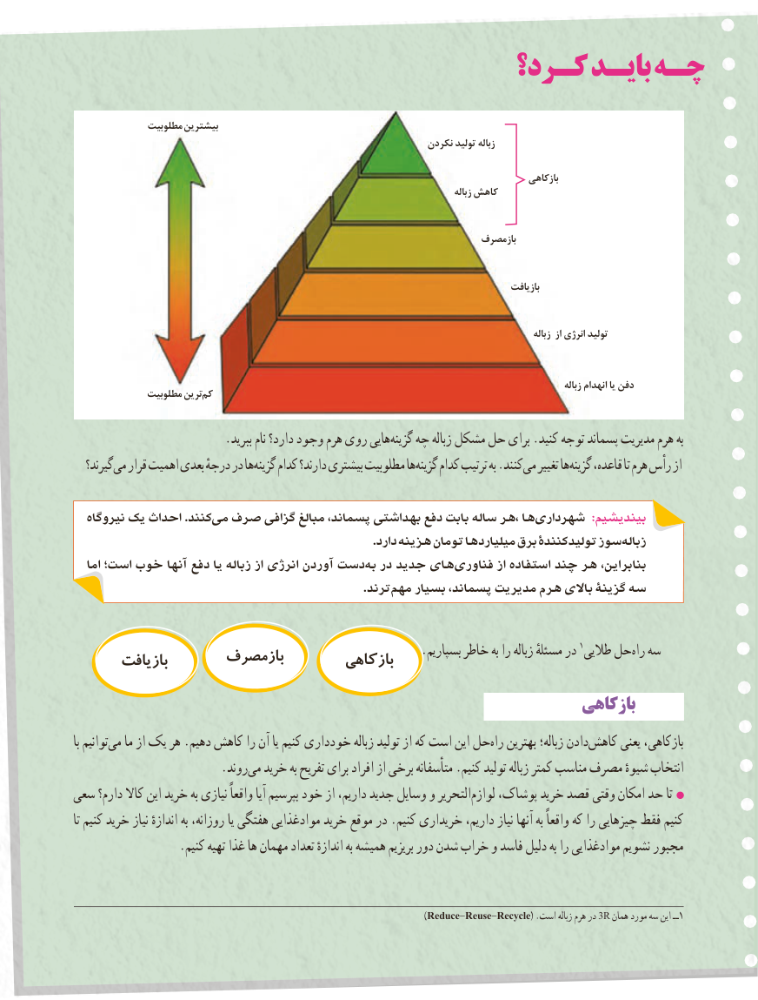

# PDF page 89

كـرد؟ بایـد چـه

               مطلوبیت بیشترین
                                                                     نکردن تولید زباله

                                                                                                         بازکاهی
                                                                                                              زباله کاهش

                                                                                 بازمصرف

                                                                                                          بازیافت

                                                                                                                                     زباله از انرژی تولید

                                                                                                                                              زباله انهدام یا دفن               مطلوبیت ترین کم

  .‏ببرید نام دارد؟ وجود هرم روی هاییگزینه چه زباله مشکل حل برای .کنید توجه پسماند مدیریت هرم به
   گیرند؟می‏  قرار اهمیت بعدی درجهٔ در هاگزینه‏    کدام دارند؟ بیشتری مطلوبیت هاگزینه‏    کدام ترتیب به .کنندمی‏   تغییر هاگزینه‏    قاعده، تا هرم رأس از

  نیروگاه یک احداث .کنندمی‏  صرف گزافی مبالغ پسماند، بهداشتی دفع بابت ساله ،هر هاشهرداری‏              :بیندیشیم
      . دارد هزینه تومان هامیلیارد برق تولیدکنندۀ سوز زباله
   اما است؛ خوب آنها دفع یا زباله از انرژی آوردن دستبه‏  در جدید هایفناوری‏         از استفاده چند هر بنابراین،
                   .‏ترندمهم بسیار پسماند، مدیریت هرم باالی گزینة سه

    .1بسپاریم خاطر به را زباله مسئلهٔ در طالیی حلراه‏  سه                  بازمصرف         بازکاهی       بازیافت
                                                                  بازکاهیبازکاهی
با توانیممی‏   ما از یک هر .دهیم کاهش را آن یا کنیم خودداری زباله تولید از که است این حلراه‏   بهترین زباله؛ دادنکاهش‏      یعنی بازکاهی،
          .‏روندمی خرید به تفریح برای افراد از برخی متأسفانه .کنیم تولید زباله کمتر مناسب مصرف شیوهٔ انتخاب
سعی دارم؟ کاال این خرید به نیازی واقعاً آیا بپرسیم خود از داریم، جدید وسایل و التحریرلوازم‏    پوشاک، خرید قصد وقتی امکان حد تا
تا کنیم خرید نیاز اندازهٔ به روزانه، یا هفتگی موادغذایی خرید موقع در .کنیم خریداری داریم، نیاز آنها به واقعاً که را چیزهایی فقط کنیم
                 .کنیم تهیه غذا ها مهمان تعداد اندازهٔ به همیشه بریزیم دور شدن خراب و فاسد دلیل به را موادغذایی نشویم مجبور

                                                                       )Reduce-Reuse-Recycle( .است زباله هرم در 3R همان مورد سه این ــ1
                                                                                    8181

