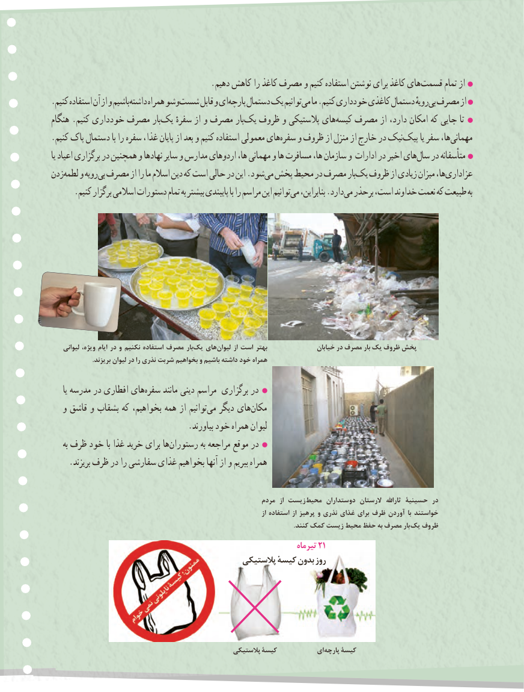

# PDF page 90

.دهیم کاهش را کاغذ مصرف و کنیم استفاده نوشتن برای کاغذ هایقسمت‏       تمام از
.کنیم استفاده آن از و باشیمداشته‏     همراه وشوشست‏     قابل و ایپارچه‏    دستمال یک توانیممی‏  ما .کنیم خودداری کاغذی دستمال رویهٔبی‏ مصرف از
هنگام .کنیم خودداری مصرف باریک‏    سفرهٔ از و مصرف باریک‏  ظروف و پالستیکی هایکیسه‏   مصرف از دارد، امکان که جایی تا
.کنیم پاک دستمال با را سفره غذا، پایان از بعد و کنیم استفاده معمولی هایسفره‏    و ظروف از منزل از خارج در نیکپیک‏      یا سفر ها،مهمانی‏
یا اعیاد برگزاری در همچنین و نهادها سایر و مدارس اردوهای ها، مهمانی و ها مسافرت ها، سازمان و ادارات در اخیر هایسال‏   در متأسفانه
زدنلطمه‏   و رویهبی‏ مصرف از را ما اسالم دین که است حالی در این .شودمی‏ پخش محیط در مصرف باریک‏  ظروف از زیادی میزان ها،عزاداری‏
.‏کنیم برگزار اسالمی دستورات تمام به بیشتر پایبندی با را مراسم این توانیممی بنابراین، .داردمی‏  برحذر است، خداوند نعمت که طبیعت به

    لیوانی ،ویژه ایام در و نکنیم استفاده مصرف باریک‏   هایلیوان‏       از است بهتر                خیابان در مصرف بار یک ظروف پخش
                         .بریزند لیوان در را نذری شربت بخواهیم و باشیم داشته خود همراه

     یا مدرسه در افطاری هایسفره‏     مانند دینی مراسم برگزاری در
   و قاشق و بشقاب که بخواهیم، همه از توانیممی‏   دیگر هایمکان‏
                                 .بیاورند خود همراه لیوان
    به ظرف خود با غذا خرید برای هارستوران‏           به مراجعه موقع در
    .بریزند ظرف در را سفارشی غذای بخواهیم آنها از و ببریم همراه

                                                             مردم  از زیست محیط دوستداران الرستان  ثاراهلل حسینیۀ در
                                                                                             از استفاده از پرهیز و نذری غذای برای ظرف آوردن با خواستند
                                                                                                                                                     .کنند کمک زیست محیط حفظ به مصرف بار یک ظروف
                                                                         تیرماه 12
                                             پالستیکی ٔکیسه بدون روز

                                                     پالستیکی8282کیسۀ           ای پارچه کیسۀ

