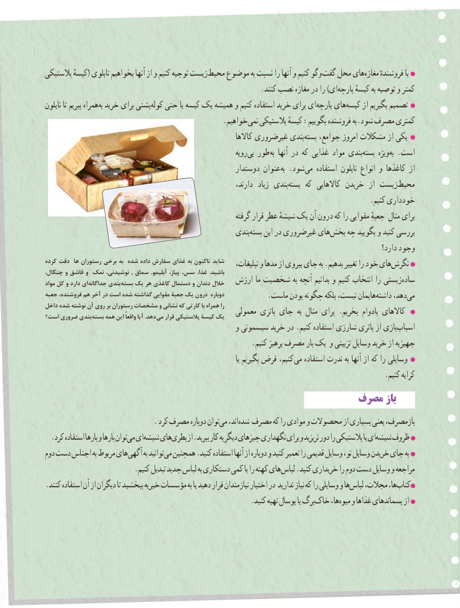

# PDF page 91

پالستیکی کیسهٔ( تابلوی بخواهیم آنها از و کنیم توجیه زیستمحیط‏    موضوع به نسبت را آنها و کنیم وگو گفت محل هایمغازه‏     فروشندهٔ با
                                                          .کنند نصب مغازه در را )ایپارچه‏     کیسهٔ به توصیه و کمتر
نایلون تا ببریم همراهبه‏ خرید برای پشتیکوله‏   حتی یا کیسه یک همیشه و کنیم استفاده خرید برای ایپارچه‏    هایکیسه‏     از بگیریم تصمیم
                                                .خواهیمنمی‏   پالستیکی کیسهٔ :بگوییم فروشنده به.شود مصرف کمتری
                                                                    کاالها غیرضروری بندیبسته‏    جوامع، امروز مشکالت از یکی
                                                                رویهبی‏  طور به آنها در که غذایی مواد بندیبسته‏     ویژهبه‏  .است
                                                       دوستدار عنوان به .شودمی‏   استفاده نایلون انواع و کاغذها از
                                                                  دارند،  زیاد بندیبسته‏     که  کاالهایی خریدن  از زیستمحیط‏
                                                                                        .کنیم خودداری
                                                                گرفته قرار عطر شیشهٔ یک آن درون که را مقوایی جعبهٔ مثال برای
                                                      بندیبسته‏    این در غیرضروری هایبخش‏    چه بگویید و کنید بررسی
                                                                                                              دارد؟ وجود
کرده دقت  ها رستوران برخی به شده داده سفارش غذای به تاکنون شاید    تبلیغات، و مدها از پیروی جای به .بدهیم تغییر را خود هاینگرش‏،چنگال و قاشق و نمک ،نوشیدنی , سماق ,آبلیمو ،پیاز ،سس ،غذا .باشید
مواد کل و دارد ای جداگانه بندی بسته یک هر کاغذی دستمال و دندان خالل   ارزش ما شخصیت به آنچه بدانیم و کنیم انتخاب را زیستیساده‏
جعبه ،فروشنده هم آخر در است شده گذاشته مقوایی جعبة یک درون دوباره    .‏ماست بودن چگونه بلکه نیست، هایمانداشته دهد،می‏
داخل شده نوشته آن روی بر رستوران مشخصات و نشانی که کارتی با همراه را   معمولی باتری جای  به مثال برای .بخریم بادوام کاالهایاست؟ ضروری بندی بسته همه این ًواقعا آیا .دهد می قرار پالستیکی کیسۀ یک
                                                    و سیسمونی خرید در .کنیم استفاده شارژی باتری از بازیاسباب‏
                                                        .کنیم پرهیز مصرف بار یک و تزیینی وسایل خرید از جهیزیه
                                                                                               یا بگیریم قرض کنیم، می استفاده ندرت به آنها از که را وسایلی
                                                                                            .کنیم کرایه
                                                  مصرفمصرف بازباز
   .‏کرد مصرف دوباره توانمی اند، شده مصرف که را موادی و محصوالت از بسیاری یعنی بازمصرف،
.‏کرد استفاده بارها و بارها توانمی ایشیشه‏    هایبطری‏     از .ببرید کار به دیگر چیزهای نگهداری برای و نریزید دور را پالستیکی یا ایشیشه‏   ظروف
دوم دست اجناس به مربوط هایآگهی‏      به توانیدمی‏  همچنین .کنید استفاده آنها از دوباره و کنید تعمیر را قدیمی وسایل نو، وسایل خریدن جای به
                        .کنیم تبدیل جدید لباس به دستکاری کمی با را کهنه های لباس .کنید خریداری را دوم دست وسایل و مراجعه
.‏کنند استفاده آن از دیگران تا ببخشید خیریه مؤسسات به یا دهید قرار نیازمندان اختیار در ندارید نیاز که را وسایلی و هالباس مجالت، ها،کتاب‏
                                                        .کنید تهیه پوسال یا برگخاک‏     ها،میوه‏   و غذاها پسماندهای از

                                                                   8383

