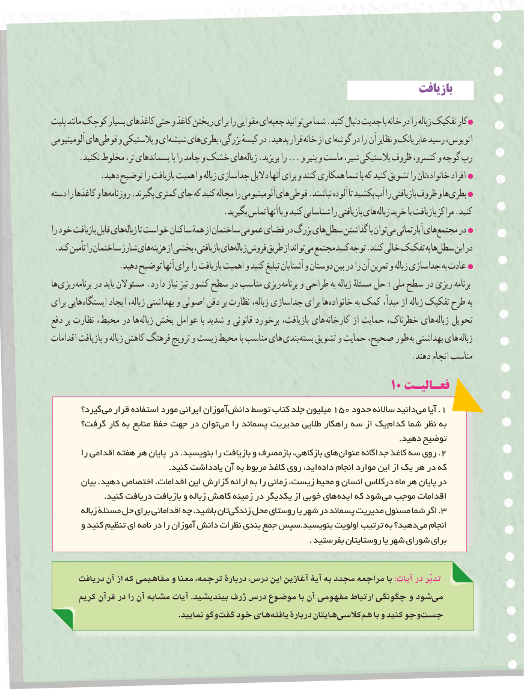

# PDF page 92

بازیافتبازیافت

بلیت مانند کوچک بسیار کاغذهای حتی و کاغذ ریختن برای را مقوایی ای جعبه توانیدمی‌  شما .کنید دنبال جدیت با خانه در را زباله تفکیک کار
آلومینیومی هایقوطی‌    و پالستیکی و ایشیشه‌    هایبطری‌    بزرگی، کیسهٔ در .بدهید قرار خانه از ایگوشه‌    در را آن نظایر و بانک عابر رسید اتوبوس،
.‌نکنید مخلوط تر، پسماندهای با را جامد و خشک هایزباله .بریزید را ... و پنیر و ماست شیر، پالستیکی ظروف کنسرو، و گوجه رب
.‌دهید توضیح را بازیافت اهمیت و زباله جداسازی دالیل آنها برای و کنند همکاری شما با که کنید تشویق را تانخانواده افراد
دسته را کاغذها و هاروزنامه‌     .بگیرند کمتری جای که کنید مچاله را آلومینیومی هایقوطی‌    .نباشند آلوده تا بکشید آب را بازیافتی ظروف و هابطری‌
                                         .بگیرید تماس آنها با و کنید شناسایی را بازیافتی هایزباله‌   خرید یا بازیافت مراکز .کنید
را خود بازیافت قابل هایزباله‌     تا خواست ساکنان همهٔ از ساختمان عمومی فضای در بزرگ هایسطل‌    گذاشتن با توانمی‌  آپارتمانی هایمجتمع‌     در
 .کند تأمین را ساختمان شارژ هایهزینه‌    از بخشی بازیافتی، هایزباله‌  فروش طریق از تواندمی‌  مجتمع کنید توجه .کنند خالی تفکیک به هاسطل‌    این در
                .دهید توضیح آنها برای را بازیافت اهمیت و کنید تبلیغ آشنایان و دوستان بین در را آن تمرین و زباله جداسازی به عادت
ها ریزی برنامه در باید مسئوالن .دارد نیاز نیز کشور سطح در مناسب ریزی برنامه و طراحی به زباله مسئلهٔ حل :ملی سطح در ریزی برنامه
برای هایی ایستگاه ایجاد زباله، بهداشتی و اصولی دفن بر نظارت زباله، جداسازی برای ها خانواده به کمک مبدأ، از زباله تفکیک طرح به
دفع بر نظارت محیط، در ها زباله پخش عوامل با شدید و قانونی برخورد بازیافت، های کارخانه از حمایت خطرناک، های زباله تحویل
اقدامات بازیافت و زباله کاهش فرهنگ ترویج و زیست محیط با مناسب های بندی بسته تشویق و حمایت صحیح، طور به بهداشتی های زباله
                                                                                      .دهند انجام مناسب
                                                              10 فعـالیـت
       گیرد؟ می قرار استفاده مورد ایرانی آموزان دانش١٥٠توسط کتاب جلد میلیون    حدود ساالنه دانید .می آیا 1
      گرفت؟ کار به منابع حفظ جهت در توان می را پسماند مدیریت طالیی راهکار سه از یک کدام شما نظر به
                                                                                                                                .دهید توضیح
         را اقدامی هفته هر پایان در .بنویسید را بازیافت و بازمصرف بازکاهی، های .عنوان جداگانه کاغذ سه روی 2
                                           .کنید یادداشت آن به مربوط کاغذ روی اید، داده انجام موارد این از یک هر در که
        بیان .دهید اختصاص اقدامات، این گزارش ارائه به را زمانی زیست، محیط و انسان درکالس ماه هر پایان در
. کنید دریافت بازیافت و زباله کاهش زمینه در یکدیگر از خوبی های ایده که شود می موجب اقدامات
         زباله مسئلة حل برای اقداماتی چه باشید، تانزندگی‌.محل روستای یا شهر در پسماند مدیریت مسئول شما اگر 3
       و کنید تنظیم ای نامه در را آموزان دانش نظرات بندی جمع سپس.بنویسید اولویت ترتیب به دهید؟می‌   انجام
                                                                                               . بفرستید روستایتان یا شهر شورای برای

      دريافت آن از كه مفاهيمي و معنا ترجمه، دربارۀ درس، اين آغازين آيۀ به مجدد مراجعه با :آیات در تدبّر
      كريم قرآن در را آن مشابه آيات .بينديشيد ژرف درس موضوع با آن مفهومی ارتباط چگونگی و شود می
                                                        .نماييد وگو گفت خود های يافته دربارۀ هايتان كالسی هم با و كنيد وجو جست

                                                                       8484

