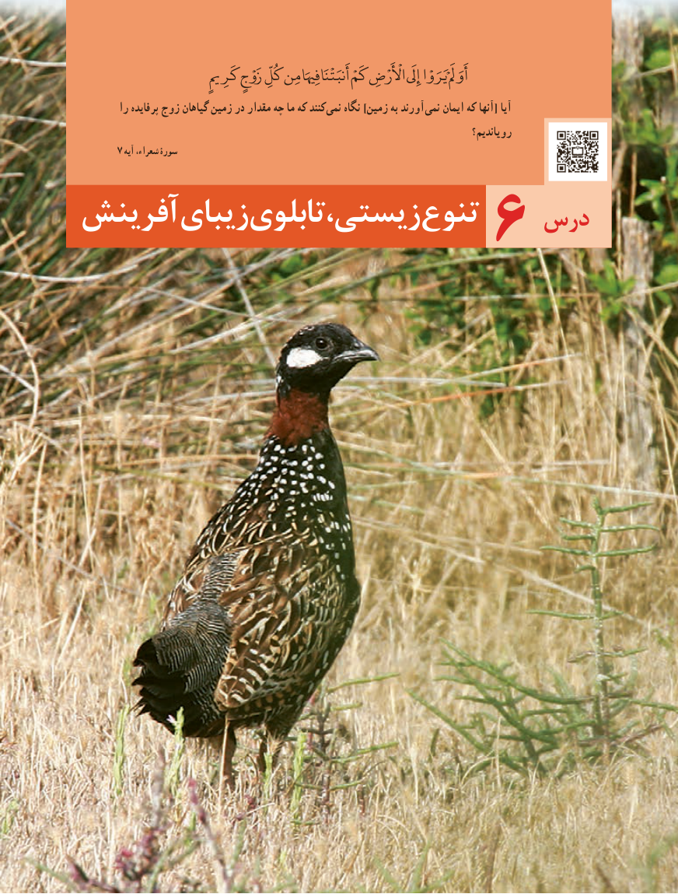

# PDF page 93

کَرِمی زَوْجٍ کُلِّ مِن فِهیَا أَنبَتْنَا کَمْ اأْلَْرْضِ إِیَلَ یَرَوْا أَوَمَلَْ
        را پرفایده زوج گیاهان زمین در مقدار چه ما که کنند نمی نگاه ]زمین به آورند نمی ایمان که آنها[ آیا
                                                                                          رویاندیم؟
       7 آیه شعراء، سورۀ
آفرینشزیبایتابلویزیستی،تنوع    درس             6

                                 8585

