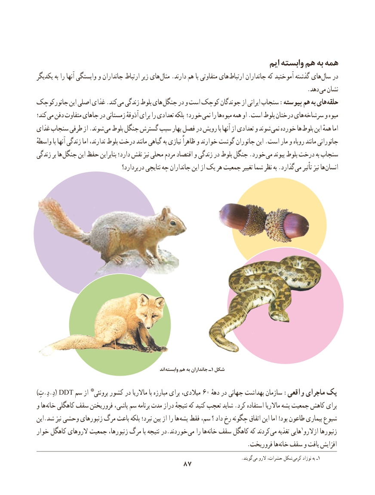

# PDF page 95

ایم وابسته هم به همه
یکدیگر به را آنها وابستگی و جانداران ارتباط زیر های مثال .دارند هم با متفاوتی های ارتباط جانداران که آموختید گذشته های سال در
                                         . دهد می نشان
جانورکوچک این اصلی غذای .کند می زندگی بلوط های جنگل در و است کوچک جوندگان از ایرانی سنجاب :پیوسته هم به های حلقه
کند؛ می دفن متفاوت جاهای در زمستانی آذوقهٔ برای را تعدادی بلکه خورد؛ نمی را ها میوه همه او .است بلوط درختان های سرشاخه و میوه
غذای سنجاب طرفی از .شوند می بلوط جنگل گسترش سبب بهار فصل در رویش با آنها از تعدادی و شوند نمی خورده ها بلوط این همهٔ اما
واسطهٔ با آنها زندگی اما ندارند، بلوط درخت مانند گیاهی به نیازی ظاهراً و خوارند گوشت جانوران این .است مار و روباه مانند جانورانی
زندگی بر ها جنگل این حفظ بنابراین دارد؛ نقش نیز محلی مردم اقتصاد و زندگی در بلوط جنگل .خورد می پیوند بلوط درخت به سنجاب
                                    بردارد؟ در نتایجی چه جانداران این از یک هر جمعیت تغییر شما نظر به .گذارد می تأثیر نیز ها انسان

                                                                     اند وابسته۱هم به جانداران ـ شکل

)تِ.دِ.دِ( DDT سم از *برونئی کشور در ماالریا با مبارزه برای میالدی، 60 دههٔیکدر جهانی بهداشت سازمان :واقعی ماجرای
و ها خانه کاهگلی سقف فروریختن پاشی، سم برنامه مدت دراز نتیجهٔ که کنید تعجب شاید .کرد استفاده ماالریا پشه جمعیت کاهش برای
این.شد نیز وحشی زنبورهای مرگ باعث بلکه نبرد؛ بین از را ها پشه فقط سم، ؟ داد رخ چگونه اتفاق این اما !بود طاعون بیماری شیوع
خوار کاهگل الروهای جمعیت زنبورها، مرگ با نتیجه در.خوردند می را ها خانه سقف کاهگل که کردند می تغذیه هایی 1ازالرو زنبورها
             . فروریخت ها خانه سقف و یافت افزایش
                                                                                               .گویند می الرو حشرات، شکل  کرمی۱نوزاد به ـ
                                  8787

