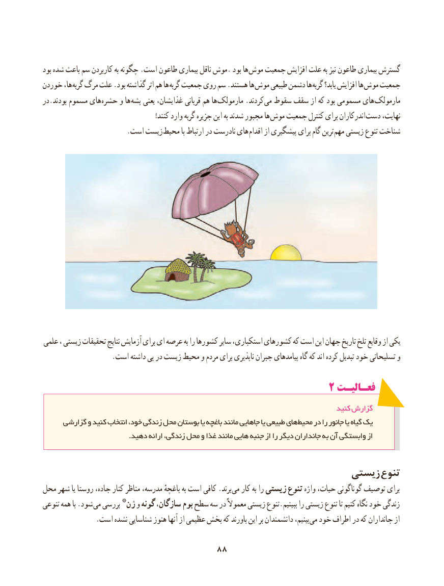

# PDF page 96

بود شده باعث سم کاربردن به چگونه .است طاعون بیماری ناقل موش. بود ها موش جمعیت افزایش علت به نیز طاعون بیماری گسترش
خوردن ها، گربه مرگ علت .بود گذاشته اثر هم ها گربه جمعیت روی سم .هستند ها موش طبیعی دشمن ها گربه یابد؟ افزایش ها موش جمعیت
در.بودند مسموم های حشره و ها پشه یعنی غذایشان، قربانی هم ها مارمولک .کردند می سقوط سقف از که بود مسمومی های مارمولک
  ! کنند وارد گربه جزیره این به شدند مجبور ها موش جمعیت کنترل برای اندرکاران دست نهایت،
    . است زیست محیط با ارتباط در نادرست های اقدام از پیشگیری برای گام ترین مهم زیستی تنوع شناخت

علمی ، زیستی تحقیقات نتایج آزمایش برای ای عرصه به را کشورها سایر استکباری، کشورهای که است این جهان تاریخ تلخ وقایع از یکی
                   .است داشته پی در زیست محیط و مردم برای ناپذیری جبران پیامدهای گاه که اند کرده تبدیل خود تسلیحاتی و

                                                  2 فعـالیـت
                                                                                   کنید گزارش
     گزارشی و کنید انتخاب خود، زندگی محل بوستان یا باغچه مانند جاهایی یا طبیعی های محیط در را جانور یا گیاه یک
                                     .دهید ارائه زندگی، محل و غذا مانند هایی جنبه از را دیگر جانداران به آن وابستگی از

                                                     زیستی تنوع
محل شهر یا روستا جاده، کنار مناظر مدرسه، باغچهٔ به است کافی .برند می کار به را زیستی تنوع واژه حیات، گوناگونی توصیف برای
تنوعی همه با .شود می بررسی *ژن و گونه سازگان، بوم سطح سه در معموالً زیستی تنوع.ببینیم را زیستی تنوع تا کنیم نگاه خود زندگی
. است نشده شناسایی هنوز آنها از عظیمی بخش که باورند این بر دانشمندان بینیم، می خود اطراف در که جانداران از

                                 8888

