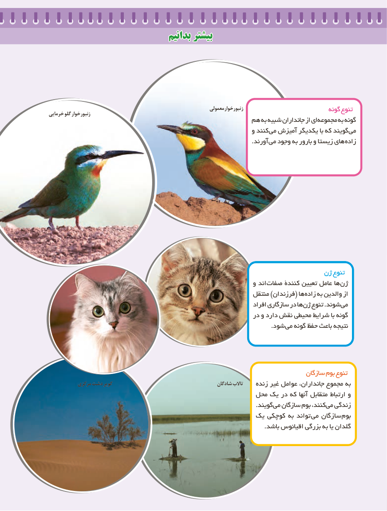

# PDF page 97

بدانیمبدانیم بیشتربیشتر

                                                                 معمولی زنبورخوار                             گونه تنوعخرمایی گلو زنبورخوار
                                               هم به  شبیه جانداران از ای مجموعه به گونه
                                                                و کنند می آمیزش یکدیگر با که گویند می
                      . آورند می وجود به بارور و زیستا های زاده

                                                                      ژن تنوع
                                                                و اند صفات کنندۀ تعیین عامل ها ژن
                                                               منتقل )فرزندان( ها زاده به والدین از
                                                                           افراد سازگاری در ها ژن تنوع .شوند می
                                                              در و دارد نقش محیطی شرایط با گونه
                             . شود می گونه حفظ باعث نتیجه

                                                                                  سازگان بوم تنوع
           مرکزی دشت کویر                                          شادگان تاالب    زنده غیر عوامل جانداران، مجموع به
                                                     محل یک در که آنها متقابل ارتباط و
                                                                                                       .گویند می سازگان بوم کنند، می زندگی
                                                یک کوچکی به تواند  می سازگان  بوم
                                                                                                           .باشد اقیانوس بزرگی به یا گلدان

                                 8989

