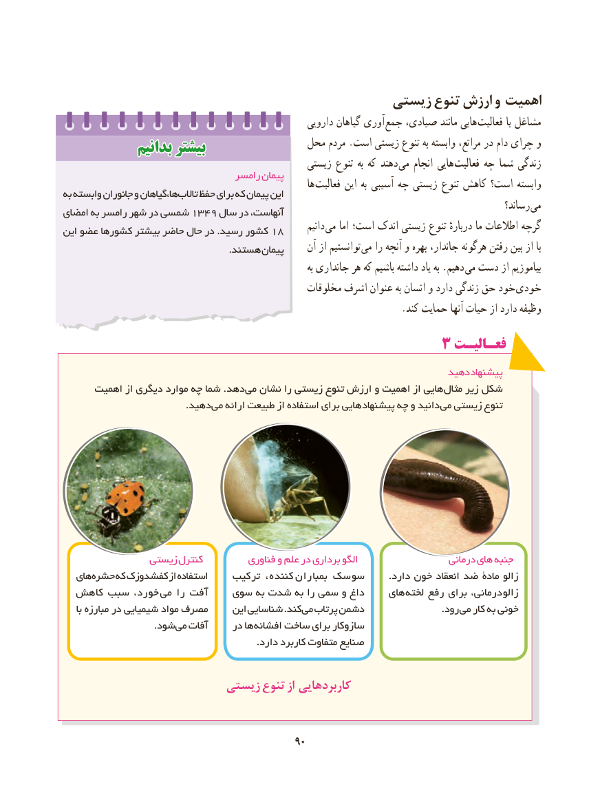

# PDF page 98

زیستی تنوع ارزش و اهمیت
                                                        دارویی گیاهان آوری جمع صیادی، مانند هایی  فعالیت یا مشاغل
             بدانیمبدانیم بیشتربیشتر                 محل مردم .است زیستی تنوع به وابسته مراتع، در دام چرای و
                                                  زیستی تنوع به که دهند  می انجام هایی فعالیت چه شما زندگی
                                  رامسر پیمان                                                                ها فعالیت این به آسیبی چه زیستی تنوع کاهش است؟ وابستهبه وابسته جانوران و ها،گیاهان تاالب حفظ برای که پیمان این
                                                                                                         رساند؟  میامضای به رامسر شهر در شمسی 1349 سال در آنهاست،
                                                                      دانیم می اما است؛ اندک زیستی تنوع دربارهٔ ما اطالعات گرچهاین عضو کشورها بیشتر حاضر حال در .رسید کشور 18
                                                     .هستند پیمان     آن از توانستیم می را آنچه و بهره جاندار، هرگونه رفتن بین از با
                                                                                 به جانداری هر که باشیم داشته یاد به .دهیم  می دست از بیاموزیم
                                                  مخلوقات اشرف عنوان به انسان و دارد زندگی حق خود  خودی
                                                                      .کند حمایت آنها حیات از دارد وظیفه
                                        3 فعـالیـت
                                                                      دهید پیشنهاد
      اهمیت از دیگری موارد چه شما .دهد می نشان را زیستی تنوع ارزش و اهمیت از هایی مثال زیر شکل
                                       .دهید می ارائه طبیعت از استفاده برای هایی پیشنهاد چه و دانید می زیستی تنوع

               زیستی کنترل          فناوری و علم در برداری الگو                    درمانی های  جنبه
   های حشره که کفشدوزک از استفاده    ترکیب کننده،  بمباران سوسک        .دارد خون انعقاد ضد مادۀ زالو
  کاهش سبب خورد،  می را آفت    سوی به شدت به را سمی و داغ    های  لخته رفع برای درمانی،  زالو
     با مبارزه در شیمیایی مواد مصرف     این شناسایی .کند می پرتاب دشمن        . رود می کار به خونی
        . شود می آفات     در ها افشانه ساخت برای سازوکار
                                                              .دارد کاربرد متفاوت صنایع

                        زیستی تنوع از کاربردهایی

                                            9090

