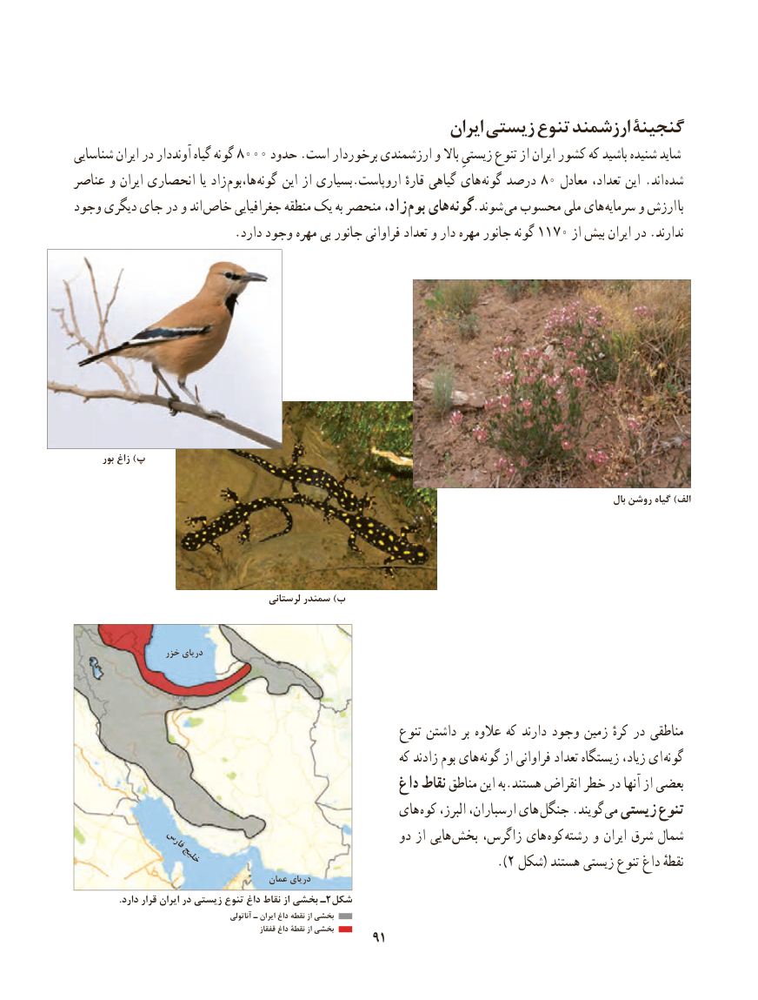

# PDF page 99

ایران زیستی تنوع ارزشمند گنجینۀ
شناسایی ایران در آونددار گیاه گونه 8000 حدود .است برخوردار ارزشمندی و باال زیستیِ تنوع از ایران کشور که باشید شنیده شاید
عناصر و ایران انحصاری یا زاد  ها،بوم گونه  این از بسیاری.اروپاست قارهٔ گیاهی های  گونه درصد 80 معادل تعداد، این .اند  شده
وجود دیگری جای در و اند خاص جغرافیایی منطقه یک به منحصر زاد، بوم های گونه.شوند  می محسوب ملی های سرمایه و ارزش با
                          .دارد وجود مهره بی جانور فراوانی تعداد و دار مهره جانور گونه 1170 از بیش ایران در .ندارند

       بور زاغ )پ

                                                                                                                                  بال روشن گیاه )الف

                                          لرستانی سمندر )ب

                   خزر دریای

                                                           تنوع داشتن بر عالوه که دارند وجود زمین کرهٔ در مناطقی
                                                             که زادند بوم های گونه از فراوانی تعداد زیستگاه زیاد، ای  گونه
                                                   داغ نقاط مناطق این به.هستند انقراض خطر در آنها از بعضی
                                                 های کوه البرز، ارسباران، های  جنگل .گویند  می زیستی تنوع
             فارس                                   دو از هایی بخش زاگرس، های  کوه رشته و ایران شرق شمال
                خلیج                                                                       ).2 شکل( هستند زیستی تنوع داغ نقطهٔ
                                          عمان دریای
.2دارد قرار ایران در زیستی تنوع داغ نقاط از بخشی ـ شکل
                                                  آناتولی ـ ایران داغ نقطه از بخشی
                                                          قفقاز داغ نقطۀ از بخشی      9191

