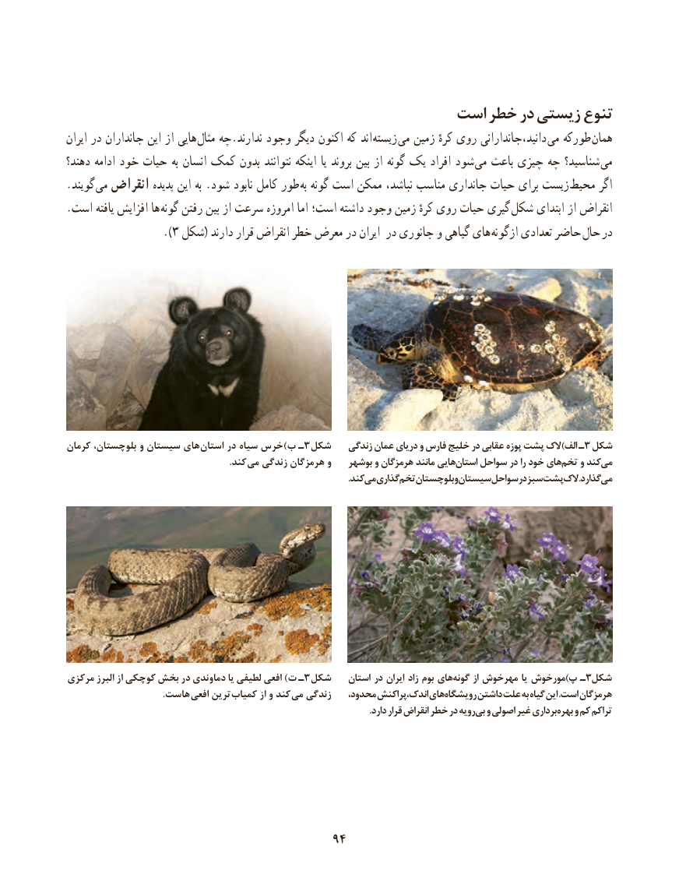

# PDF page 102

است خطر در زیستی تنوع
ایران در جانداران این از هایی مثال چه.ندارند وجود دیگر اکنون که اند زیسته می زمین کرهٔ روی دانید،جاندارانی می طورکه همان
دهند؟ ادامه خود حیات به انسان کمک بدون نتوانند اینکه یا بروند بین از گونه یک افراد شود می باعث چیزی چه شناسید؟ می
.گویند  می انقراض پدیده این به .شود نابود کامل طور  به گونه است ممکن نباشد، مناسب جانداری حیات برای زیست محیط اگر
. است یافته افزایش ها گونه رفتن بین از سرعت امروزه اما است؛ داشته وجود زمین کرهٔ روی حیات گیری شکل ابتدای از انقراض
                  ).3 شکل( دارند قرار انقراض خطر معرض در ایران در جانوری و گیاهی های ازگونه تعدادی حاضر حال در

کرمان بلوچستان، و سیستان های  استان در سیاه خرس)ب ـ3شکل   زندگی عمان دریای و فارس خلیج در عقابی پوزه پشت الک)الف ـ3 شکل
                . کند می زندگی هرمزگان و   بوشهر و هرمزگان مانند هاییاستان     سواحل در را خود هایتخم     و کندمی
                              . کندمیگذاریتخم    بلوچستانوسیستانسواحلدرسبزپشتالک      .گذاردمی

مرکزی البرز از کوچکی بخش در دماوندی یا لطیفی افعی )ت ـ3شکل    استان در ایران زاد بوم های گونه از مهرخوش یا مورخوش)پ ـ3شکل
      . هاست افعی ترین کمیاب از و کند می زندگی   محدود، اندک،پراکنش های رویشگاه داشتن علت به گیاه این .است هرمزگان
      . دارد قرار انقراض خطر در رویهبی و اصولی غیر برداری بهره و کم تراکم

                                      9494

