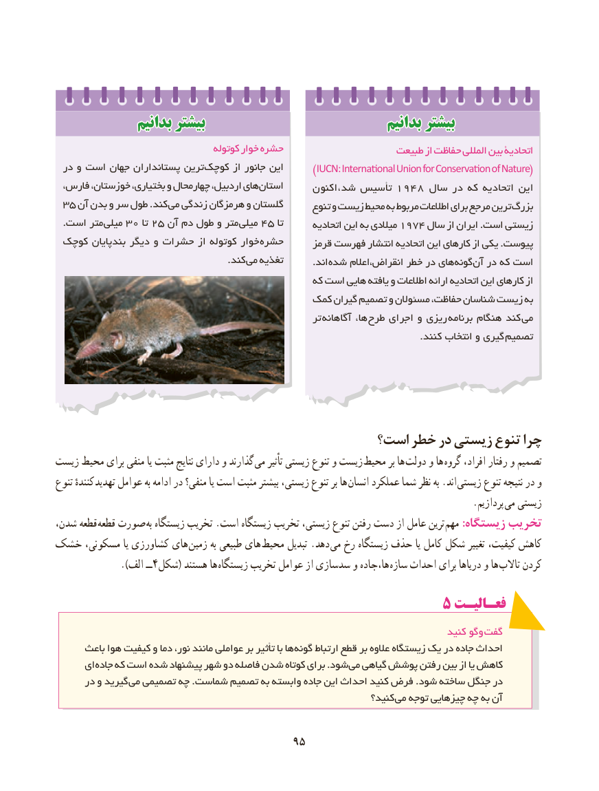

# PDF page 103

بدانیمبدانیم بیشتربیشتر                                بدانیمبدانیم بیشتربیشتر
                                    کوتوله خوار حشره                    طبیعت از حفاظت المللی بین اتحادیۀ
 در و است جهان پستانداران ترین کوچک از جانور این      )IUCN: International Union for Conservation of Nature(
 فارس، خوزستان، بختیاری، و چهارمحال اردبیل، های استان      اکنون‌، شد تأسیس 1948 سال در که اتحادیه این
 35 آن بدن و سر طول .کند می زندگی هرمزگان و گلستان      تنوع و زیست محیط به مربوط اطالعات برای مرجع ترین بزرگ
  .است متر میلی 30 تا 25 آن دم طول و متر میلی 45 تا       اتحادیه این به میالدی 1974 سال از ایران .است زیستی
 کوچک بندپایان دیگر و حشرات از کوتوله خوار  حشره      قرمز فهرست انتشار اتحادیه این کارهای از یکی .پیوست
                 . کند می تغذیه   . اند شده انقراض،اعالم خطر در های گونه آن در که است
                                                  که است هایی یافته و اطالعات ارائه اتحادیه این کارهای از
                                        کمک گیران تصمیم و مسئوالن حفاظت، شناسان زیست به
                                                          تر  آگاهانه ها،  طرح اجرای و ریزی  برنامه هنگام کند  می
        . کنند انتخاب و گیری تصمیم

                                        است؟ خطر در زیستی تنوع چرا
زیست محیط برای منفی یا مثبت نتایج دارای و گذارند می تأثیر زیستی تنوع و زیست محیط بر ها  دولت و ها گروه افراد، رفتار و تصمیم
تنوع کنندهٔ تهدید عوامل به ادامه در منفی؟ یا است مثبت بیشتر زیستی، تنوع بر ها انسان عملکرد شما نظر به .اند  زیستی تنوع نتیجه در و
                         . پردازیم می زیستی
شدن، قطعه  قطعه صورت به زیستگاه تخریب .است زیستگاه تخریب زیستی، تنوع رفتن دست از عامل ترین مهم :زیستگاه تخریب
خشک مسکونی، یا کشاورزی های زمین به طبیعی های محیط تبدیل .دهد  می رخ زیستگاه حذف یا کامل شکل تغییر کیفیت، کاهش
     ).4الف ــ شکل( هستند ها زیستگاه تخریب عوامل از سدسازی و ها،جاده سازه احداث برای دریاها و ها تاالب کردن
                                             5 فعـالیـت
                                                                                  کنید وگو گفت
      باعث هوا کیفیت و دما نور، مانند عواملی بر تأثیر با ها گونه ارتباط قطع بر عالوه زیستگاه یک در جاده احداث
      ای جاده که است شده پیشنهاد شهر دو فاصله شدن کوتاه برای .شود می گیاهی پوشش رفتن بین از یا کاهش
      در و گیرید می تصمیمی چه .شماست تصمیم به وابسته جاده این احداث کنید فرض .شود ساخته جنگل در
                                                                   کنید؟ می توجه چیزهایی چه به آن

                                      9595

