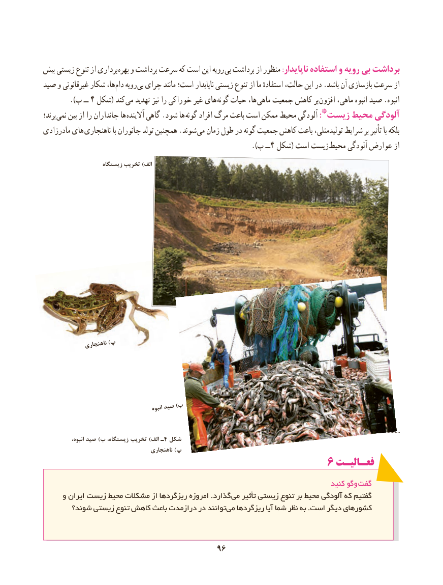

# PDF page 104

بیش زیستی تنوع از برداری بهره و برداشت سرعت که است این رویه بی برداشت از منظور :ناپایدار استفاده و رویه بی برداشت
صید و غیرقانونی شکار ها، دام رویه بی چرای مانند است؛ ناپایدار زیستی تنوع از ما استفادهٔ حالت، این در .باشد آن بازسازی سرعت از
   ).4ب ــ  شکل( کند می تهدید نیز را خوراکی غیر های گونه حیات ها، ماهی جمعیت کاهش بر  افزون ماهی، انبوه صید .انبوه
برند؛ نمی بین از را جانداران ها  آالینده گاهی .شود ها  گونه افراد مرگ باعث است ممکن محیط آلودگی *:زیست محیط آلودگی
مادرزادی های ناهنجاری با جانوران تولد همچنین .شوند  می زمان طول در گونه جمعیت کاهش باعث تولیدمثلی، شرایط بر تأثیر با بلکه
                           ).4پ ــ شکل( است زیست محیط آلودگی عوارض از
                     زیستگاه تخریب )الف                                                       الف

              ناهنجاری )پ

                                             انبوه صید )ب

                                                                                                                                                                                                                                               ....................
              انبوه، صید )ب زیستگاه، تخریب )الف ـ4 شکل                                  ب
                                       ناهنجاری )پ
                                             6 فعـالیـت
                                                                                 کنید وگو گفت
     و ایران زیست محیط مشکالت از ریزگردها امروزه .گذارد می تأثیر زیستی تنوع بر محیط آلودگی که گفتیم
       شوند؟ زیستی تنوع کاهش باعث درازمدت در توانند می ریزگردها آیا شما نظر به .است دیگر کشورهای

                                       9696

