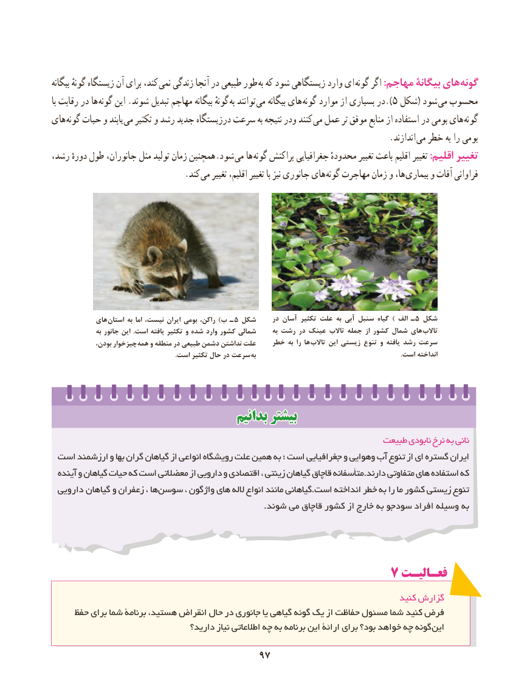

# PDF page 105

بیگانه گونهٔ زیستگاه آن برای کند، نمی زندگی آنجا در طبیعی طور به که شود زیستگاهی وارد ای  گونه اگر :مهاجم بیگانۀ های گونه
با رقابت در ها  گونه این .شوند تبدیل مهاجم بیگانه گونهٔ  به توانند می بیگانه های ).گونه موارد از بسیاری در 5 شکل( شود  می محسوب
های گونه حیات و یابند می تکثیر و رشد جدید درزیستگاه سرعت به نتیجه ودر کنند می عمل تر موفق منابع از استفاده در بومی های گونه
                       . اندازند می خطر به را بومی
رشد، دورهٔ طول جانوران، مثل تولید زمان همچنین.شود می ها گونه پراکنش جغرافیایی محدودهٴ تغییر باعث اقلیم تغییر :اقلیم تغییر
               . کند می تغییر اقلیم، تغییر با نیز جانوری های گونه مهاجرت زمان و ها، بیماری و آفات فراوانی

            های استان به اما نیست، ایران بومی راکن، )ب ـ  5 شکل     در آسان تکثیر علت به آبی سنبل گیاه ) الف ـ 5 شکل
                به جانور این  .است یافته تکثیر و شده وارد کشور شمالی      به رشت در عینک تاالب جمله از کشور شمال های  تاالب
              بودن، چیزخوار  همه و منطقه در طبیعی دشمن نداشتن علت    خطر به را ها  تاالب این زیستی تنوع و یافته رشد سرعت
   . است تکثیر حال در سرعت به                                                                                        .است انداخته

                                    بدانیمبدانیم بیشتربیشتر
                                                                    طبیعت نابودی نرخ به نانی
 است ارزشمند و بها گران گیاهان از انواعی رویشگاه علت همین به ؛ است جغرافیایی و وهوایی آب تنوع از ای گستره ایران
  آینده و گیاهان حیات که است معضالتی از دارویی و اقتصادی ، زینتی گیاهان قاچاق متأسفانه.دارند متفاوتی های استفاده که
 دارویی گیاهان و زعفران ، ها سوسن ، واژگون های الله انواع مانند گیاهانی.است انداخته خطر به را ما کشور زیستی تنوع
                                                                             .شوند می قاچاق کشور از خارج به سودجو افراد وسیله به

                                           7 فعـالیـت
                                                                                  کنید گزارش
     حفظ برای شما برنامۀ هستید، انقراض حال در جانوری یا گیاهی گونه یک از حفاظت مسئول شما کنید فرض
                                  دارید؟ نیاز اطالعاتی چه به برنامه این ارائۀ برای بود؟ خواهد چه گونه این

                                     9797

