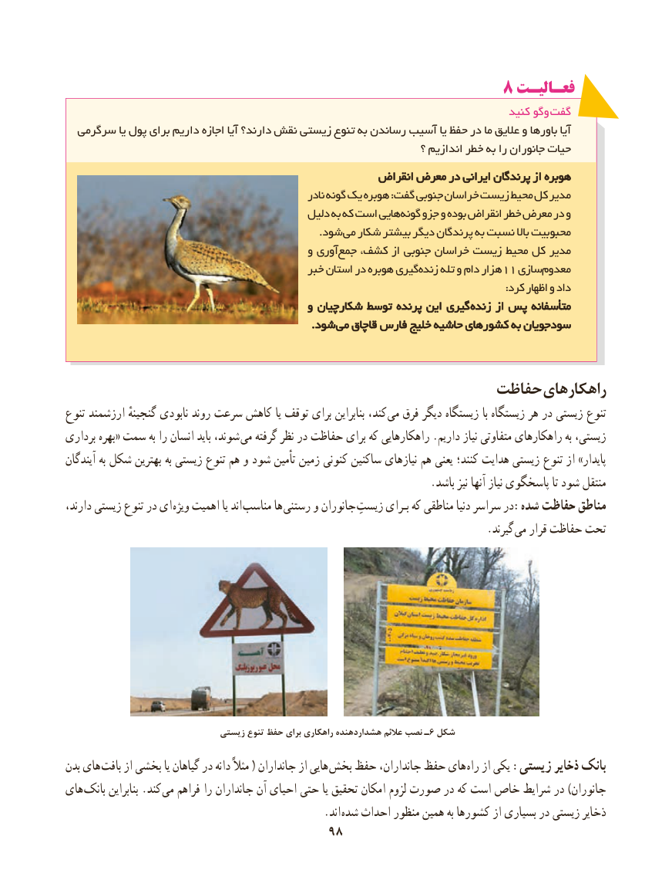

# PDF page 106

8 فعـالیـت
                                                                                   کنید وگو گفت
  سرگرمی یا پول برای داریم اجازه آیا دارند؟ نقش زیستی تنوع به رساندن آسیب یا حفظ در ما عالیق و باورها آیا
                                                                       ؟ اندازیم خطر به را جانوران حیات
                                                     انقراضانقراض معرضمعرض دردر ایرانیایرانی پرندگانپرندگان ازاز هوبرههوبره
                                                        نادر گونه یک هوبره :گفت جنوبی خراسان زیست محیط کل مدیر
                                            دلیل به که است هایی گونه جزو و بوده انقراض خطر معرض در و
                   . شود می شکار بیشتر دیگر پرندگان به نسبت باال محبوبیت
                                            و آوری جمع کشف، از جنوبی خراسان زیست محیط کل مدیر
                                            خبر استان در هوبره گیری زنده تله و دام هزار11 سازی معدوم
                                                                                                                              :کرد اظهار و داد
                                            وو شکارچیانشکارچیان توسطتوسط پرندهپرنده ایناین گیریگیری  زندهزنده ازاز پسپس متأسفانهمتأسفانه
                                                                      ..شودشود  میمی قاچاققاچاق فارسفارس خلیجخلیج حاشیهحاشیه کشورهایکشورهای بهبه سودجویانسودجویان

                                              حفاظت راهکارهای
تنوع ارزشمند گنجینهٔ نابودی روند سرعت کاهش یا توقف برای بنابراین کند، می فرق دیگر زیستگاه با زیستگاه هر در زیستی تنوع
برداری بهره« سمت به را انسان باید شوند،  می گرفته نظر در حفاظت برای که راهکارهایی .داریم نیاز متفاوتی راهکارهای به زیستی،
آیندگان به شکل بهترین به زیستی تنوع هم و شود تأمین زمین کنونی ساکنین نیازهای هم یعنی کنند؛ هدایت زیستی تنوع از »پایدار
                                                                    .باشد نیز آنها نیاز پاسخگوی تا شود منتقل
دارند، زیستی تنوع در ای ویژه اهمیت یا اند مناسب ها  رستنی و جانوران زیستﺑایﺮـ که مناطقی دنیا سراسر در:شده حفاظت مناطق
                            . گیرند می قرار حفاظت تحت

                               زیستی تنوع حفظ برای راهکاری هشداردهنده عالئم نصب ـ6 شکل
بدن های بافت از بخشی یا گیاهان در دانه مثالً ( جانداران از هایی بخش حفظ جانداران، حفظ های راه از یکی :زیستی ذخایر بانک
های بانک بنابراین .کند می فراهم را جانداران آن احیای حتی یا تحقیق امکان لزوم صورت در که است خاص شرایط در )جانوران
                          . اند شده احداث منظور همین به کشورها از بسیاری در زیستی ذخایر
                                    9898

