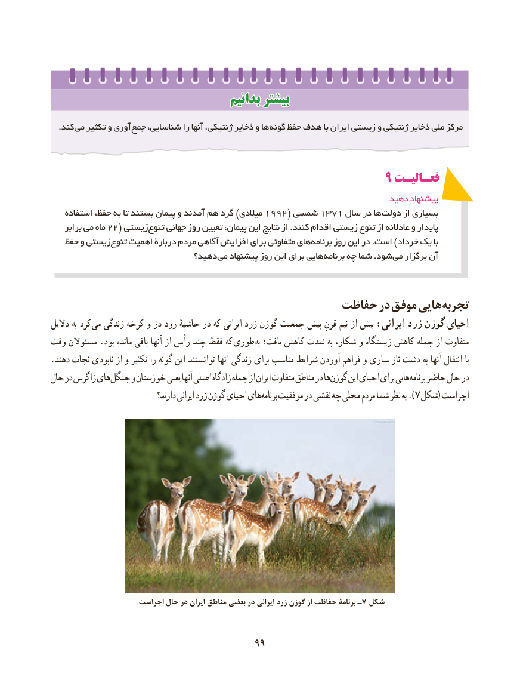

# PDF page 107

بدانیمبدانیم بیشتربیشتر

   .کند می تکثیر و آوری جمع شناسایی، را آنها ژنتیکی، ذخایر و ها گونه حفظ هدف با ایران زیستی و ژنتیکی ذخایر ملی مرکز

                                                       9 فعـالیـت
                                                                      دهید پیشنهاد
    استفاده حفظ، به تا بستند پیمان و آمدند هم گرد )میالدی 1992( شمسی 1371 سال در ها دولت از بسیاری
    برابر مِی ماه 22( زیستی تنوع جهانی روز تعیین پیمان، این نتایج از .کنند اقدام زیستی تنوع از عادالنه و پایدار
   حفظ و زیستی تنوع اهمیت دربارۀ مردم آگاهی افزایش برای متفاوتی های برنامه روز این در .است )خرداد یک با
                               دهید؟ می پیشنهاد روز این برای هایی برنامه چه شما .شود می برگزار آن

                                        حفاظت در موفق هایی تجربه
دالیل به کرد می زندگی کرخه و دز رود حاشیهٔ در که ایرانی زرد گوزن جمعیت پیش قرنِ نیم از بیش :ایرانی زرد گوزن احیای
وقت مسئوالن .بود مانده باقی آنها از رأس چند فقط که طوری به یافت؛ کاهش شدت به شکار، و زیستگاه کاهش جمله از متفاوت
.دهند نجات نابودی از و تکثیر را گونه این توانستند آنها زندگی برای مناسب شرایط آوردن فراهم و ساری ناز دشت به آنها انتقال با
حال در زاگرس های جنگل و خوزستان یعنی آنها اصلی زادگاه جمله از ایران متفاوت مناطق در ها گوزن این احیای برای هایی برنامه حاضر حال در
                                  دارند؟ ایرانی زرد گوزن احیای های ).برنامه موفقیت در نقشی چه محلی مردم شما نظر به    7 شکل( اجراست

                                                .اجراست حال در ایران مناطق بعضی در ایرانی زرد گوزن از حفاظت برنامۀ ـ7 شکل

                                       9999

