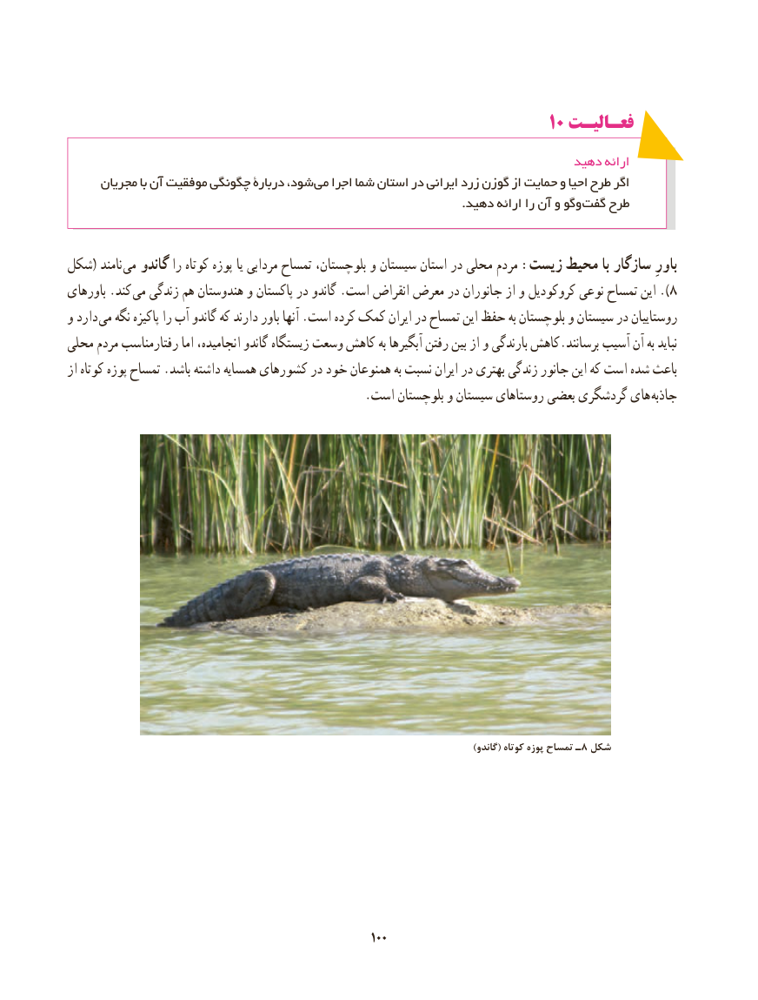

# PDF page 108

10 فعـالیـت

                                                                       دهید ارائه
     مجریان با آن موفقیت چگونگی دربارۀ شود، می اجرا شما استان در ایرانی زرد گوزن از حمایت و احیا طرح اگر
      . دهید ارائه را آن و وگو گفت طرح

شکل( نامند می گاندو را کوتاه پوزه یا مردابی تمساح بلوچستان، و سیستان استان در محلی مردم :زیست محیط با سازگار باورِ
باورهای .کند ).می زندگی هم هندوستان و پاکستان در گاندو .است انقراض معرض در جانوران از و کروکودیل نوعی تمساح این  8
و دارد  می نگه پاکیزه را آب گاندو که دارند باور آنها .است کرده کمک ایران در تمساح این حفظ به بلوچستان و سیستان در روستاییان
محلی مردم رفتارمناسب اما انجامیده، گاندو زیستگاه وسعت کاهش به آبگیرها رفتن بین از و بارندگی کاهش.برسانند آسیب آن به نباید
از کوتاه پوزه تمساح .باشد داشته همسایه کشورهای در خود همنوعان به نسبت ایران در بهتری زندگی جانور این که است شده باعث
  . است بلوچستان و سیستان روستاهای بعضی گردشگری های جاذبه

       )8گاندو( کوتاه پوزه تمساح ـ شکل

                                                       100100

