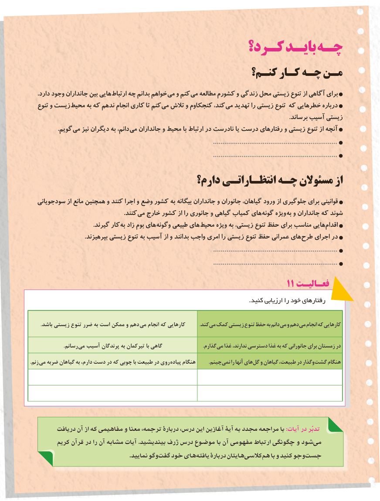

# PDF page 109

كـرد؟ بایـد چـه
                                          کنـم؟ کـار چـه مـن
. دارد وجود جانداران بین هایی ارتباط چه بدانم خواهم می و کنم می مطالعه کشورم و زندگی محل زیستی تنوع از آگاهی برای
   تنوع و زیست محیط به که ندهم انجام کاری تا کنم می تالش و کنجکاوم کند، می تهدید را زیستی تنوع که خطرهایی درباره
                                                                                                                                                                               .برساند آسیب زیستی
   . گویم می نیز دیگران به دانم، می جانداران و محیط با ارتباط در نادرست یا درست رفتارهای و زیستی تنوع از آنچه
                                                                                                .................................................................
                                                                                                .................................................................
                                   دارم؟ انتظـاراتـی چـه مسئوالن از
  سودجویانی از مانع همچنین و کنند اجرا و وضع کشور به بیگانه جانداران و جانوران گیاهان، ورود از جلوگیری برای قوانینی
                                                               .کنند می خارج کشور از را جانوری و گیاهی کمیاب های گونه ویژه به و جانداران که شوند
    . گیرند کار به زاد بوم های وگونه طبیعی های محیط ویژه به زیستی، تنوع حفظ برای مناسب هایی اقدام
                                     .بپرهیزند زیستی تنوع به آسیب از و بدانند واجب امری را زیستی تنوع حفظ عمرانی های طرح اجرای در
                                                                                                .................................................................
                                                                                                .................................................................
                                                                   11 فعـالیـت
                                                                                                               .کنید ارزیابی را خود رفتارهای

. باشد زیستی تنوع ضرر به است ممکن و دهم می انجام که کارهایی           .کند می کمک زیستی تنوع حفظ به دانم می و دهم می انجام که کارهایی

    . رسانم می آسیب پرندگان به تیرکمان با گاهی     . گذارممی غذا ندارند، دسترسی غذا به که جانورانی برای زمستان در
. زنم می ضربه گیاهان به دارم، دست در که چوبی با طبیعت در روی پیاده هنگام  . چینمنمی را آنها های گل و گیاهان طبیعت، در وگذار گشت هنگام

         دريافت آن از كه مفاهيمي و معنا ترجمه، دربارۀ درس، اين آغازين آيۀ به مجدد مراجعه با :آیات در تدبّر
         كريم قرآن در را آن مشابه آيات .بينديشيد ژرف درس موضوع با آن مفهومی ارتباط چگونگی و شود می
                                                            .نماييد وگو گفت خود های يافته دربارۀ هايتان كالسی هم با و كنيد وجو جست
                                                         101101

