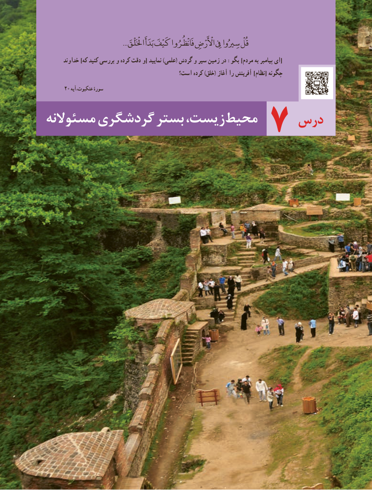

# PDF page 111

...َقُلْاخْلَْلْق بَدَأَ كَيْفَ فَانْظُرُوا اأْلَْرْضِ یِفِ سِريُوا
       خداوند ]که کنید بررسی و کرده دقت و[ نمایید )علمی( گردش و سیر زمین در :بگو ]مردم به پیامبر ای[
                                         است؟ کرده )خلق( آغاز را آفرینش ]نظام[ چگونه
       20 عنکبوت،آیه سورۀ
مسئوالنه گردشگری بستر زیست، محیط     درس            7

                                          103103

