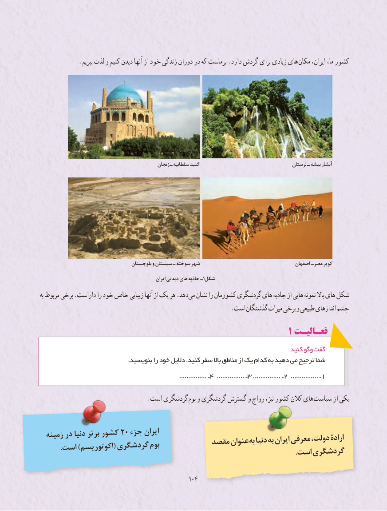

# PDF page 112

.ببریم لذت و کنیم دیدن آنها از خود زندگی دوران در که برماست .دارد گردش برای زیادی های مکان ایران، ما، کشور

                                                 زنجان ـ سلطانیه گنبد                                      لرستان ـ بیشه آبشار

                                    بلوچستان و سیستان ـ سوخته شهر                                      اصفهان مصرـ کویر
                                                           ایران دیدنی های جاذبه ـ1شکل
به مربوط برخی .داراست را خود خاص زیبایی آنها از یک هر .دهد می نشان را کشورمان گردشگری های جاذبه از هایی نمونه باال های شکل
                                                              .است گذشتگان میراث برخی و طبیعی اندازهای چشم
                                                                1 فعـالیـت
                                                                                 کنید وگو گفت
                                            .بنویسید را خود دالیل .کنید سفر باال مناطق از یک کدام به دهید می ترجیح شما
                                                                ...............4ـ    ............... ـ 3 ............... ـ 2 ............... ـ 1

     . است گردشگری بوم و گردشگری گسترش و رواج نیز، کشور کالن های سیاست از یکی

  زمینه در دنیا برتر کشور 20 جزء ایران                                    مقصد عنوانبه‌ دنیا به ایران معرفی دولت، ارادۀ        .است )اکوتوریسم( گردشگری بوم                                                                                                         .است گردشگری

                                              104104

