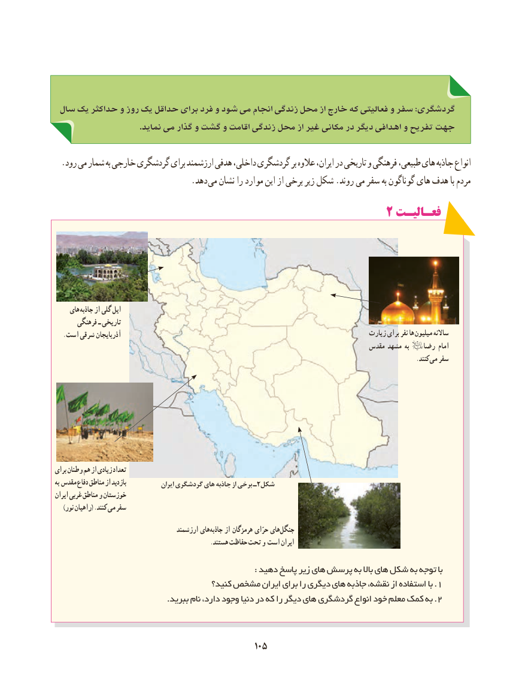

# PDF page 113

سال یک حداکثر و روز یک حداقل برای فرد و شود می انجام زندگی محل از خارج که فعالیتی و سفر :گردشگری
                                     .نماید می گذار و گشت و اقامت زندگی محل از غیر مکانی در دیگر اهدافی و تفریح جهت

  .رود می شمار به خارجی گردشگری برای ارزشمند هدفی داخلی، گردشگری بر عالوه ایران، در تاریخی و فرهنگی طبیعی، های جاذبه انواع
               . دهد می نشان را موارد این از برخی زیر شکل .روند می سفر به گوناگون های هدف با مردم
                                                 2 فعـالیـت

     های جاذبه از گلی ایل
       فرهنگی ـ تاریخی
   .است شرقی آذربایجان                                                                         زیارت برای نفر ها میلیون ساالنه
                                                                                مقدس مشهد به          رضا امام
                                                                                                                         .کنند می سفر

برای وطنان هم از زیادی تعداد
به مقدس دفاع مناطق از بازدید             ایران گردشگری های جاذبه از برخی ـ2شکل
ایران غربی مناطق و خوزستان
    )نور راهیان( .کنند می سفر
                                       ارزشمند های جاذبه از هرمزگان حرّای های جنگل
                                                    .هستند حفاظت تحت و است ایران

                                                                          : دهید پاسخ زیر های پرسش به باال های شکل به توجه با
                                       کنید؟ مشخص ایران برای را دیگری های جاذبه نقشه، از استفاده با . 1
 ..ببرید نام دارد، وجود دنیا در که را دیگر های گردشگری انواع خود معلم کمک به 2

                                             105105

