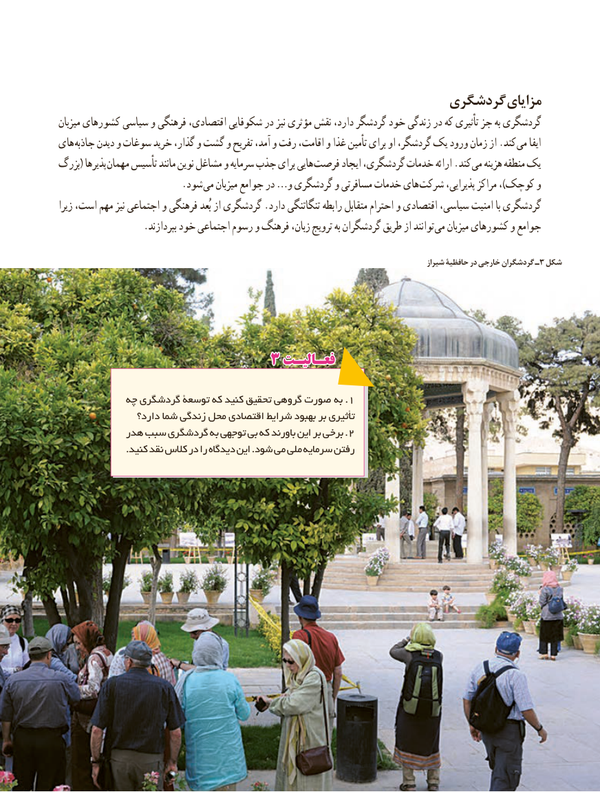

# PDF page 114

گردشگری مزایای
میزبان کشورهای سیاسی و فرهنگی اقتصادی، شکوفایی در نیز مؤثری نقش دارد، گردشگر خود زندگی در که تأثیری جز به گردشگری
های جاذبه دیدن و سوغات خرید گذار، و گشت و تفریح آمد، و رفت اقامت، و غذا تأمین برای او گردشگر، یک ورود زمان از .کند می ایفا
بزرگ( پذیرها مهمان تأسیس مانند نوین مشاغل و سرمایه جذب برای هایی فرصت ایجاد گردشگری، خدمات ارائه .کند می هزینه منطقه یک
          . شود می میزبان جوامع در …و گردشگری و مسافرتی خدمات های شرکت پذیرایی، مراکز ،)کوچک و
زیرا است، مهم نیز اجتماعی و فرهنگی بُعد از گردشگری .دارد تنگاتنگی رابطه متقابل احترام و اقتصادی سیاسی، امنیت با گردشگری
 . بپردازند خود اجتماعی رسوم و فرهنگ زبان، ترویج به گردشگران طریق از توانند می میزبان کشورهای و جوامع

                   شیراز٣حافظیۀ در خارجی گردشگران ـ شکل

                      3 فعـالیـتفعـالیـت

            چه گردشگری توسعۀ که کنید تحقیق گروهی صورت  .به 1
                 دارد؟ شما زندگی محل اقتصادی شرایط بهبود بر تأثیری
            هدر سبب گردشگری به توجهی بی که باورند این بر برخی . 2
                      .کنید نقد کالس در را دیدگاه این .شود می ملی سرمایه رفتن

                                               106106

