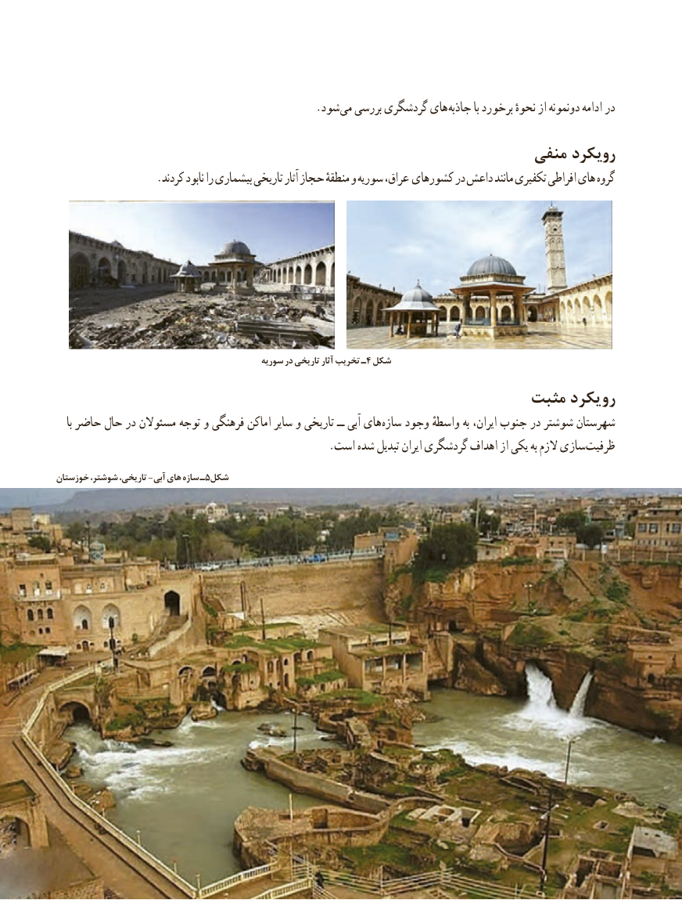

# PDF page 115

. شود می بررسی گردشگری های جاذبه با برخورد نحوهٔ از دونمونه ادامه در
                                                         منفی رویکرد
                  .کردند نابود را بیشماری تاریخی آثار حجاز منطقهٔ و سوریه عراق، کشورهای در داعش مانند تکفیری افراطی های گروه

           سوریه٤در تاریخی آثار تخریب ـ شکل
                                                      مثبت رویکرد
    با حاضر حال در مسئوالن توجه و فرهنگی اماکن سایر و تاریخی ــ آبی های سازه وجود واسطهٔ به ایران، جنوب در شوشتر شهرستان
  . است شده تبدیل ایران گردشگری اهداف از یکی به الزم سازی ظرفیت
خوزستان شوشتر، تاریخی، -آبی های سازه ـ5شکل

                                               107107

