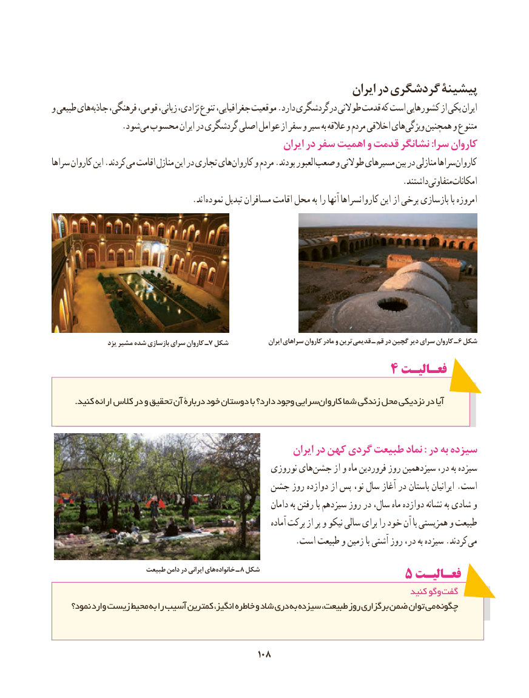

# PDF page 116

ایران در گردشگری پیشینۀ
و طبیعی های جاذبه فرهنگی، قومی، زبانی، نژادی، تنوع جغرافیایی، موقعیت .دارد درگردشگری طوالنی قدمت که است کشورهایی از یکی ایران
                 .شود می محسوب ایران در گردشگری اصلی عوامل از سفر و سیر به عالقه و مردم اخالقی های ویژگی همچنین و متنوع
                                                        ایران در سفر اهمیت و قدمت نشانگر :سرا کاروان
سراها کاروان این .کردند می اقامت منازل این در تجاری های کاروان و مردم .بودند العبور صعب و طوالنی مسیرهای بین در منازلی سراها کاروان
                                                                                   .داشتندمتفاوتیامکانات
                   . اند نموده تبدیل مسافران اقامت محل به را آنها کاروانسراها این از برخی بازسازی با امروزه

  یزد٧مشیر شده بازسازی سرای کاروان ـ شکل               ایران سراهای کاروان مادر و ترین قدیمی ـ قم در گچین دیر سرای کاروان ـ ٦ شکل
                                           4 فعـالیـت

. کنید ارائه کالس در و تحقیق آن دربارۀ خود دوستان با دارد؟ وجود سراییکاروان شما زندگی محل نزدیکی در آیا

                                                          ایران در کهن گردی طبیعت نماد : در به سیزده
                                                  نوروزی های جشن از و ماه فروردین روز سیزدهمین در، به سیزده
                                   جشن روز دوازده از پس نو، سال آغاز در باستان ایرانیان .است
                                                               دامان به رفتن با سیزدهم روز در سال، ماه دوازده نشانه به شادی و
                                                                        آماده برکت از پر و نیکو سالی برای را خود آن با همزیستی و طبیعت
                                                         .است طبیعت و زمین با آشتی روز در، به سیزده .کردند می
                        طبیعت دامن در ایرانی های خانواده ـ 8 شکل                   5 فعـالیـت
                                                                                     کنید وگو گفت
     نمود؟ وارد زیست محیط به را آسیب کمترین انگیز، خاطره و شاد دری به سیزده طبیعت، روز برگزاری ضمن توان می چگونه

                                             108108

