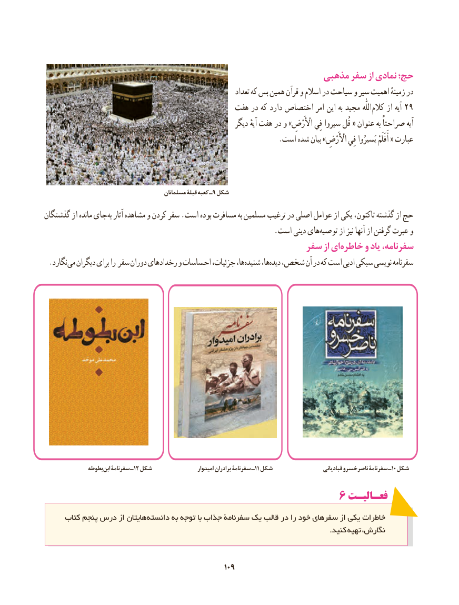

# PDF page 117

مذهبی سفر از نمادی حج؛
                                                                  تعداد که بس همین قرآن و اسالم در سیاحت و سیر اهمیت زمینهٴ در
                                          هفت در که دارد اختصاص امر این به مجید  اللّٰه کالم از آیه 29
                                                          دیگر آیهٔ هفت در و »اْألَرْضِ فِي سیروا قُل « عنوان به صراحتاً آیه
                                                                .است شده بیان »اْألَرْضِ فِي یَسیرُوا أَفَلَمْ « عبارت

                                           مسلمانان قبلۀ کعبه ـ9 شکل
گذشتگان از مانده جایبه​  آثار مشاهده و کردن سفر .است بوده مسافرت به مسلمین ترغیب در اصلی عوامل از یکی تاکنون، گذشته از حج
                                                              .است دینی هایتوصیه​      از نیز آنها از گرفتن عبرت و
                                                  سفر از ای خاطره و یاد سفرنامه،
 .نگارد می دیگران برای را سفر دوران رخدادهای و احساسات جزئیات، ها،شنیده‌     ها،دیده‌  شخص، آن در که است ادبی سبکی نویسی سفرنامه‌

              بطوطه ابن سفرنامۀ ـ12 شکل                   امیدوار برادران سفرنامۀ ـ 11 شکل                     قبادیانی ناصرخسرو سفرنامۀ ـ10 شکل

                                             6 فعـالیـت
     کتاب  پنجم درس از هایتان دانسته به توجه با جذاب سفرنامۀ یک قالب در را خود سفرهای از یکی خاطرات
                                                                                                                        .کنید تهیه نگارش،

                                                109109

