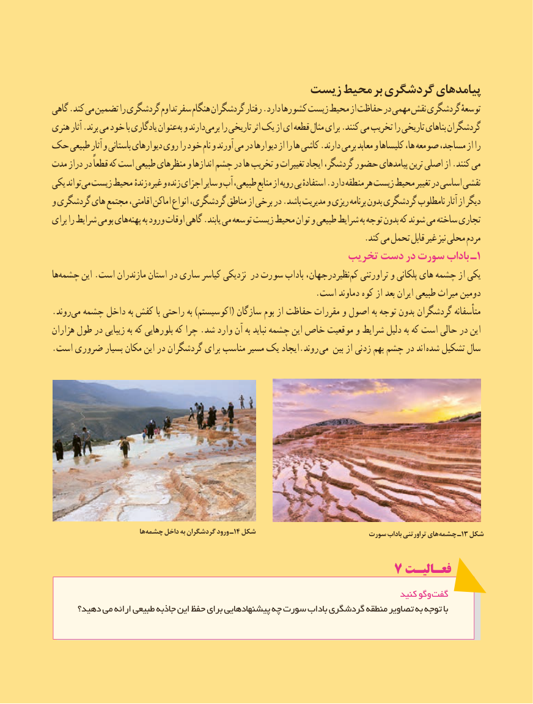

# PDF page 118

زیست محیط بر گردشگری پیامدهای
گاهی .کند می تضمین را گردشگری تداوم سفر هنگام گردشگران رفتار .دارد کشورها زیست محیط از حفاظت در مهمی نقش گردشگری توسعهٔ
هنری آثار .برند می خود با یادگاری عنوان به و دارند برمی را تاریخی اثر یک از ای قطعه مثال برای .کنند می تخریب را تاریخی بناهای گردشگران
حک طبیعی آثار و باستانی دیوارهای روی را خود نام و آورند می در دیوارها از را ها کاشی .دارند برمی معابد و کلیساها ها، صومعه مساجد، از را
مدت دراز در قطعاً که است طبیعی منظرهای و اندازها چشم در ها تخریب و تغییرات ایجاد گردشگر، حضور پیامدهای ترین اصلی از .کنند می
یکی تواند می زیست محیط زندهٔ غیره و زنده اجزای سایر و آب طبیعی، منابع از رویه بی استفادهٔ .دارد منطقه هر زیست محیط تغییر در اساسی نقشی
و گردشگری های مجتمع اقامتی، اماکن انواع گردشگری، مناطق از برخی در .باشد مدیریت و ریزی برنامه بدون گردشگری نامطلوب آثار از دیگر
برای را شرایط بومی های پهنه به ورود اوقات گاهی .یابند می توسعه زیست محیط توان و طبیعی شرایط به توجه بدون که شوند می ساخته تجاری
                                                                         .کند می تحمل قابل غیر نیز محلی مردم
                                                تخریب دست در سورت باداب ـ ١
ها‌چشمه این .است مازندران استان در ساری کیاسر نزدیکی در سورت باداب نظیردرجهان،کم‌  تراورتنی و پلکانی های چشمه از یکی
                                                              .است دماوند کوه از بعد ایران طبیعی میراث دومین
.روند‌می چشمه داخل به کفش با راحتی به )اکوسیستم( سازگان بوم از حفاظت مقررات و اصول به توجه بدون گردشگران متأسفانه
هزاران طول در زیبایی به که بلورهایی که چرا .شد وارد آن به نباید چشمه این خاص موقعیت و شرایط دلیل به که است حالی در این
. است ضروری بسیار مکان این در گردشگران برای مناسب مسیر یک ایجاد.روند می بین از زدنی بهم چشم در اند  شده تشکیل سال

                             ها چشمه١٤داخل به گردشگران ورود ـ  شکل                          سورت باداب تراورتنی های چشمه١٣ـ  شکل

                                           7 فعـالیـت
                                                                                  کنید وگو گفت
     دهید؟ می ارائه طبیعی جاذبه این حفظ برای پیشنهادهایی چه سورت باداب گردشگری منطقه تصاویر به توجه با

                                                      110110

